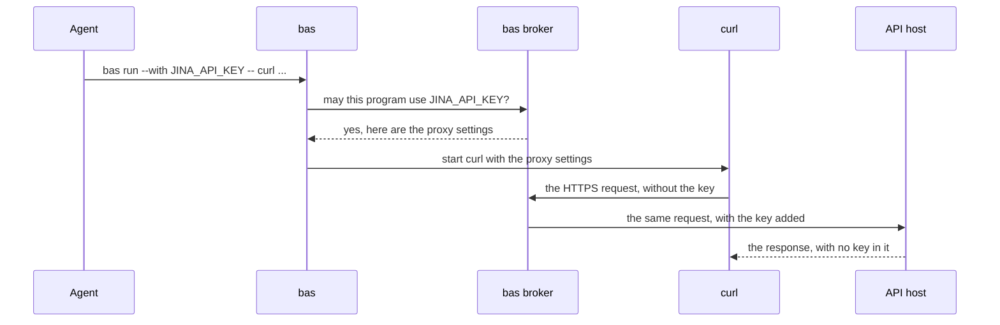
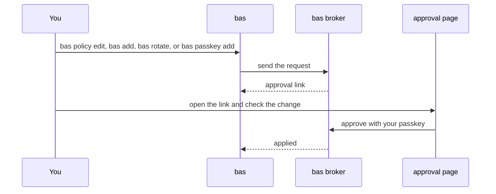

# Bitwarden Agent Secrets

`bas` lets coding agents use secrets from Bitwarden Secrets Manager without seeing the values. An agent names a secret, and `bas` adds the value where it's needed, so the value stays out of the agent's commands, output, and transcript. The full documentation is at <https://bjoernaagaard.github.io/bas/>.

`bas` isn't ready for production use yet. The source is under the MIT license.

## Choose a setup

You can use `bas` in two ways, and the broker is the safer one because programs never get a raw value.

```text
on(choose setup)
  if the machine runs Linux with systemd, or macOS with a standard daily account
    install the broker                      programs never see values
  else
    use direct access                       the program gets the value in its environment
```



## Quick start for agents

An agent needs two things on the machine, which are the `bas` program and the agent skill that tells it how to use `bas`.

First, install `bas`. With mise, run the command below. Without mise, download the archive for your platform from the [releases page](https://github.com/bjoernaagaard/bas/releases) and put `bas` on your `PATH`.

```sh
mise use -g github:bjoernaagaard/bas
bas --version
```

Second, install the agent skill, which works with Claude Code, Codex, and other agents that read skills.

```sh
npx skills add bjoernaagaard/bas --skill bitwarden-agent-secrets
```

Third, let the agent list what it can use. The command depends on the setup.

```text
on(agent starts work)
  if /run/bas/broker.sock or /var/run/bas/broker.sock exists
    bas policy show                          every credential the broker holds, never values
  else
    bas auth list                            profiles on this machine
    bas find --profile NAME [KEY]            secrets as bas://NAME/<id>, never values
```

## What an agent runs

On a broker machine, the agent uses each kind of policy entry in the way the table shows. `bas policy show` prints the exact command for every entry.

| Policy entry | What the agent runs | What happens |
|---|---|---|
| API key | `bas run --with NAME -- command` | The broker adds the key to the allowed HTTPS requests |
| Value for a config file | `bas get bas://profile/<id>` in a `"!cmd"` setting | The tool reads the value when it starts |
| SSH key | `ssh host`, `git push` | The broker's ssh-agent signs, and git commits are signed |
| GitHub | `gh pr list`, `git push` | The broker adds a one-hour token for the repository |
| Tailscale | `bas run --with tailscale -- command` | The broker adds a Tailscale API token |

Without a broker, the agent passes a reference to `bas run`, and `bas` puts the value in the program's environment for that one run.

```sh
bas auth login                                    # paste a machine account token when it asks
bas find --profile default API
bas run --env "API_TOKEN=bas://default/<secret-id>" -- your-command
```

## Set up the broker on Linux

The broker runs as a separate system user, and it keeps the machine account token and every secret away from your own user. You need a Secrets Manager machine account and its access token, systemd, and an HTTPS address for the approval pages, e.g., Tailscale Serve.

First, install the program, the `bas` user, and the sealed token. Run the commands from the extracted release archive, which includes `contrib/`.

```sh
sudo install -o root -g root -m 0755 bas /usr/local/bin/bas
sudo useradd --system --home-dir /var/lib/bas --no-create-home --shell /usr/sbin/nologin bas
sudo install -d -o root -g root -m 0700 /etc/credstore.encrypted
sudo sh -c 'systemd-ask-password -n "Machine token for the bas broker:" \
  | systemd-creds encrypt --name=bws - /etc/credstore.encrypted/bas-bws.cred'
```

Second, install the service and its settings, and start it.

```sh
sudo install -o root -g root -m 0644 contrib/linux/bas-broker.service /etc/systemd/system/
sudo install -d -o root -g root -m 0755 /etc/bas
sudo install -o root -g root -m 0644 contrib/linux/broker.toml.example /etc/bas/broker.toml
sudoedit /etc/bas/broker.toml                     # set the profile, project, and approval origin
sudo systemctl daemon-reload && sudo systemctl enable --now bas-broker
```

Third, publish the approval pages over HTTPS and enroll a passkey, such as a YubiKey. Open the enrollment link in a browser on a device that can use the passkey.

```sh
sudo tailscale serve --service=svc:bas --https=443 127.0.0.1:793
sudo cat /var/lib/bas/enroll-url
```

Fourth, write a policy that lists what agents may use, and approve it with the passkey. `bas policy edit` prints the approval link and waits.

```sh
install -d -m 0700 ~/.config/bas
install -m 0600 contrib/policy.toml.example ~/.config/bas/policy.toml
bas policy edit
```

Fifth, put the shims on `PATH` and point `ssh` and git at the broker, so `gh`, `ssh`, and commit signing go through it.

```sh
sudo install -d -o root -g root -m 0755 /usr/local/lib/bas/shims
sudo install -o root -g root -m 0755 contrib/linux/shims/gh contrib/linux/shims/ssh-keygen /usr/local/lib/bas/shims/
sudo install -o root -g root -m 0644 contrib/linux/ssh_config.d/10-bas.conf /etc/ssh/ssh_config.d/
sudo git config --system gpg.ssh.program /usr/local/lib/bas/shims/ssh-keygen
export PATH="/usr/local/lib/bas/shims:$PATH"      # or put it in your shell or mise config
```

The broker setup leaves these files on the machine:

```text
/usr/local/bin/bas                            the program
/etc/systemd/system/bas-broker.service        runs bas broker as the bas user
/etc/credstore.encrypted/bas-bws.cred         the sealed machine account token
/etc/bas/broker.toml                          profile, project, and approval origin
/var/lib/bas/                                 active policy, passkeys, proxy certificate
/run/bas/broker.sock                          where bas talks to the broker
/usr/local/lib/bas/shims/                     gh and ssh-keygen through the broker
~/.config/bas/policy.toml                     your next policy proposal
```

On macOS, a LaunchDaemon runs the broker as the `_bas` account, with the files from `contrib/macos/` and paths under `/var/run/bas/`. The [macOS section of the install guide](https://bjoernaagaard.github.io/bas/broker/install.html#install-on-macos) lists the commands.

## Check that it works

Run these commands after the setup, and use the name of any API key entry from your policy.

```sh
bas policy show                                   # lists every entry, without values
bas run --with JINA_API_KEY -- true               # starts, because the entry exists
bas run --with NOT_IN_POLICY -- true              # refused, because the entry doesn't exist
bas audit --since 10m                             # what the broker allowed and refused
bas tui                                           # browse the policy and pending approvals
```

## Change what agents may use

Every change to the broker needs an approval with an enrolled passkey. The broker waits for approval and applies the change after you approve it.



| To do this | Run |
|---|---|
| Add an API key, typing the value on the approval page | `bas add NAME --host HOST --allow "POST /v1/*"` |
| Change the policy | `bas policy edit` |
| Replace a stored value | `bas rotate NAME` |
| List the passkeys that can approve | `bas passkey list` |
| Replace every passkey with new ones | `bas passkey add --replace` |

## Connect an MCP client

On Linux and macOS, `bas mcp` serves the broker to an MCP client over stdin and stdout. Add it to the client's configuration as a stdio server.

```json
{ "mcpServers": { "bas": { "command": "bas", "args": ["mcp"] } } }
```

The server has three read-only tools, and none of them returns a secret value or can approve, deny, or change a request.

| Tool | What it returns |
|---|---|
| `policy_entries` | The policy hash, and each entry's kind, name, rules, and command, without raw policy text or header templates |
| `broker_status` | The broker version, the policy hash, and the requests that wait for approval |
| `approve_pending` | The state of one approval, given its `id`, after waiting up to `wait_seconds` (0 to 25) |

The server speaks [MCP 2025-11-25](https://modelcontextprotocol.io/specification/2025-11-25). For a pending request, it returns a URL elicitation error when the client declares support. Any other client gets the link as text in the tool result. A person still approves with a passkey on that page. Cancelling a call only stops the wait, and the request stays as it is. Retrying reads the same request again.

Approval states are `pending`, `approved`, `denied`, `expired`, and `failed`. `approved` means the broker applied the change. `failed` means a passkey approved it, but the broker could not apply it. The tool returns no approval result payload or error details. An unknown request or a refused lookup returns a tool error.

The server runs as the user who starts it, so the broker allows it only when that uid is in `broker.toml`. It uses `BAS_BROKER_SOCKET` like the other commands, and it stops when stdin closes.

## Documentation

| Page | What it covers |
|---|---|
| [Install bas](https://bjoernaagaard.github.io/bas/getting-started/install.html) | Releases and building from source |
| [Find and use secrets](https://bjoernaagaard.github.io/bas/getting-started/use-secrets.html) | `bas find`, `bas run`, and reference templates |
| [How the broker works](https://bjoernaagaard.github.io/bas/broker/overview.html) | The proxy, the ssh-agent, minted tokens, and approvals |
| [Install the broker](https://bjoernaagaard.github.io/bas/broker/install.html) | Every step on Linux and macOS, with the files in [`contrib/`](contrib) |
| [Policy](https://bjoernaagaard.github.io/bas/broker/policy.html) | Every table a policy can hold |
| [Lock down the host](https://bjoernaagaard.github.io/bas/broker/lock-down.html) | What must be true for the broker to keep values from agents |
| [Commands](https://bjoernaagaard.github.io/bas/reference/commands.html) | Every command and option |

The pages are also in [`docs/src`](docs/src), and the agent skill is in [`skills/bitwarden-agent-secrets/SKILL.md`](skills/bitwarden-agent-secrets/SKILL.md).
