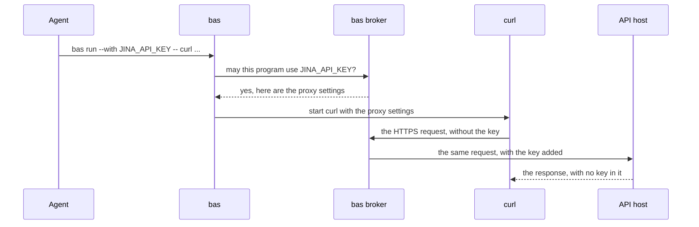

# Bitwarden Agent Secrets

`bas` lets a coding agent, e.g., Claude Code or Codex, use the API keys, SSH keys, and GitHub tokens you keep in Bitwarden Secrets Manager without seeing a value.

```sh
bas run --with JINA_API_KEY -- curl https://api.jina.ai/v1/embeddings -d @request.json
```

The agent names a secret, and `bas` adds the value where it's needed, so the value stays out of the agent's commands, output, and transcript. `bas` isn't ready for production use yet, and the source is under the MIT license.

## What bas does

`bas` works in two setups, and the broker setup gives an agent more because programs then never get a raw value.

| Feature | What the agent runs | Needs the broker |
|---|---|---|
| A key added on the way to the API host | `bas run --with NAME -- command` | Yes |
| SSH and signed git commits without a key file | `ssh host`, `git push` | Yes |
| A one-hour GitHub token for one repository | `gh pr list` | Yes |
| A Tailscale API token | `bas run --with tailscale -- command` | Yes |
| A change that waits for your passkey | `bas add NAME`, `bas policy edit` | Yes |
| A record of each use and each refusal | `bas audit --since 1h` | Yes |
| A list of secrets as references, never values | `bas find --profile NAME` | No |
| A value in one program's environment, hidden in its output | `bas run --env KEY=bas://NAME/<id> -- command` | No |
| Secrets on a machine that holds no token | `bas pair`, and you approve each request | No |
| A terminal view of secrets and the policy | `bas tui` | No |
| A read-only MCP server for the policy and pending approvals | `bas mcp` | Yes |

With the broker, the program sends its request without the key, and the broker adds the key on the way out.



## Set up

Give your agent the message below, and it does every step except the sign-in, which you do yourself so that the token stays out of the chat.

```text
Install bas with `mise use -g github:bjoernaagaard/bas`, install its skill with
`npx skills add bjoernaagaard/bas --skill bitwarden-agent-secrets`, and then run
`bas doctor` and tell me what is left.
```

```text
setup
  agent   mise use -g github:bjoernaagaard/bas      installs bas
  agent   npx skills add bjoernaagaard/bas ...      installs the skill that teaches the agent bas
  you     bas auth login                            paste a machine account token when it asks
  agent   bas doctor                                reports what is ready and what is left
```

Without mise, download the archive for your platform from the [releases page](https://github.com/bjoernaagaard/bas/releases) and put `bas` on your `PATH`.

## Add the broker

Run one command as root on Linux with systemd, and paste the machine account token when it asks. You also need an HTTPS address for the approval pages, e.g., Tailscale Serve, and a passkey, e.g., a YubiKey.

```sh
sudo "$(command -v bas)" broker install \
  --organization <organization-id> --project <project-id> \
  --origin https://bas.example.com
```

```text
bas broker install                      # prints its plan first, and --dry-run stops there
  the bas system user                   holds the token and every secret, away from your own user
  the sealed token                      goes from a hidden prompt into systemd-creds, never through an argument
  bas-broker.service                    runs the broker
  the gh and ssh-keygen shims           send gh, ssh, and commit signing through the broker
then you                                # the install guide has each step
  publish the approval pages, enroll your passkey, and approve a first policy
  bas doctor --broker                   exits 0 when the broker works
```

A second run changes nothing, and a run after an update installs the new release. The [install guide](https://bjoernaagaard.github.io/bas/broker/install.html) has the remaining steps and the commands for macOS.

## Check what you install

Every release archive has a build provenance record, which says that GitHub Actions built it from this repository at the release tag. mise checks the record on every install, and you can check an archive yourself.

```sh
gh attestation verify bas-Linux-X64.tar.gz -R bjoernaagaard/bas
```

## Documentation

Read the full guides at <https://bjoernaagaard.github.io/bas/>, starting from the page that matches your task.

| Page | What it covers |
|---|---|
| [Find and use secrets](https://bjoernaagaard.github.io/bas/getting-started/use-secrets.html) | `bas find`, `bas run`, and reference templates |
| [How the broker works](https://bjoernaagaard.github.io/bas/broker/overview.html) | The proxy, the ssh-agent, GitHub tokens, and approvals |
| [Policy](https://bjoernaagaard.github.io/bas/broker/policy.html) | What agents may use, and how you change it |
| [Lock down the host](https://bjoernaagaard.github.io/bas/broker/lock-down.html) | What must be true for the broker to keep values from agents |
| [Commands](https://bjoernaagaard.github.io/bas/reference/commands.html) | Every command and option, including `bas mcp` |
