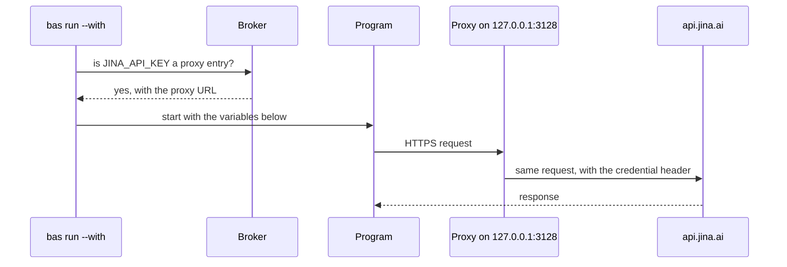
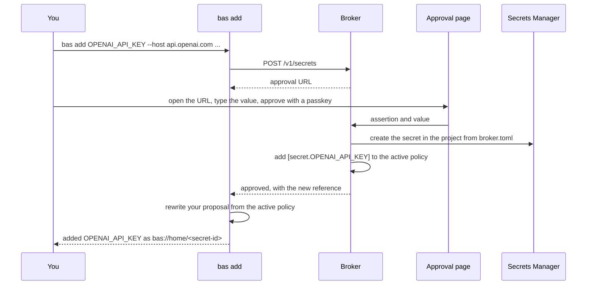

# Daily use

Use `bas run --with NAME` to give a program a credential through the broker, and use `bas add`, `bas rotate`, or `bas policy edit` to change what the broker holds after you approve with a passkey. You and your agents run the same commands on a broker host.

| Command | Needs an approval | What it does |
|---|---|---|
| `bas policy show` | No | Lists every entry of the active policy and how to use it, without values |
| `bas run --with NAME -- CMD` | No | Runs `CMD` with proxy settings for the policy entry `NAME` |
| `bas get REF` | No | Prints the value of a `[helper.NAME]` entry, for a credential helper |
| `bas add NAME --host H --allow "METHOD /path"` | Yes | Creates a secret and a `[secret.NAME]` entry, with a value you type on the approval page |
| `bas rotate NAME` | Yes for a stored value, no for `github` and `tailscale` | Replaces a stored value, or drops minted tokens |
| `bas policy edit` | Yes | Sends your edited policy proposal |
| `bas passkey list` | No | Lists the passkeys that can approve requests |
| `bas passkey add` | Yes | Enrolls one more passkey, or replaces all of them with `--replace` |
| `bas audit` | No | Prints the broker's audit entries |

## Use a credential with bas run --with

`bas run --with NAME` starts the program with proxy settings, and the proxy adds the credential to the program's HTTPS requests for the entry's host, so the program never receives the value. `NAME` must be a `[secret.NAME]` entry, `github`, or `tailscale` in the active policy.

```sh
bas run --with JINA_API_KEY -- curl -s https://api.jina.ai/v1/embeddings -H 'content-type: application/json' -d @request.json
bas run --with JINA_API_KEY --with tailscale -- ./script.sh
```



`bas run --with` sets the variables below in the program's environment. On macOS, the CA bundle is `/var/run/bas/ca-bundle.pem` instead.

```text
HTTPS_PROXY=http://127.0.0.1:3128
https_proxy=http://127.0.0.1:3128
SSL_CERT_FILE=/run/bas/ca-bundle.pem
CURL_CA_BUNDLE=/run/bas/ca-bundle.pem
REQUESTS_CA_BUNDLE=/run/bas/ca-bundle.pem
NODE_EXTRA_CA_CERTS=/run/bas/ca-bundle.pem
GIT_SSL_CAINFO=/run/bas/ca-bundle.pem
```

Most HTTPS clients read one of the variables, e.g. curl, git, Python `requests`, and Node.js with `NODE_USE_ENV_PROXY=1`. A program that ignores proxy variables reaches the host directly without the credential, and the host refuses it.

The program doesn't start when a name isn't in the active policy.

```text
$ bas run --with NOPE -- true
bas: not started: the bas broker denied NOPE: it is not a proxy entry of the active policy
```

`bas run --env NAME=bas://...` still works on a broker host with a direct or remote profile, and it puts the value in the program's environment. Remove direct profiles and remote pairings on a host where agents must not receive raw values.

## Add a new API key

Run `bas add` to create a secret and its policy entry with one approval. You type the value on the approval page, so the value never passes through a terminal on the broker host.

```sh
bas add OPENAI_API_KEY --host api.openai.com --allow "POST /v1/*" --allow "GET /v1/models"
```



| Option | Default | Rule |
|---|---|---|
| `NAME` | none | A valid environment variable name, which also becomes the key of the new secret |
| `--host` | none | Each host can belong to one entry only |
| `--header` | `Authorization` | Set it with `--value` for an API that wants another header, as in `--header x-api-key --value "{secret}"` |
| `--value` | `Bearer {secret}` | Holds `{secret}` exactly once |
| `--allow` | none | Repeat it for each allowed request |

## Rotate a credential

Create the new key at the provider first, and then run `bas rotate NAME` to replace the value of a `[secret.NAME]` entry. Open the approval page, type the new value, and approve, and the broker updates the secret in Secrets Manager. Revoke the old key at the provider after the rotation.

```sh
bas rotate OPENAI_API_KEY
bas rotate github
bas rotate tailscale
```

`bas rotate github` and `bas rotate tailscale` need no approval. They drop the broker's cached tokens, and the next request mints new ones.

To replace an SSH key, change the secret in Secrets Manager, and then restart the broker, which is `sudo systemctl restart bas-broker` on Linux. The broker loads SSH keys when it starts and when a policy change is approved.

## Change the policy

Run `bas policy edit` to change the policy. It opens your proposal in `$VISUAL` or `$EDITOR`, and after you save and quit, it sends the proposal and waits for your passkey.

```text
bas policy edit
├── no proposal yet         copy the active policy to the proposal
├── open the proposal in the editor
├── send it to the broker
│   ├── same as the active policy    print "nothing to approve" and stop
│   ├── invalid                      print the error with its line number and stop
│   └── otherwise                    print the diff and the approval URL
└── wait for the approval, then rewrite the proposal from the active policy
```

The proposal is `policy.toml` in your configuration directory.

| Platform | Proposal path |
|---|---|
| Any, when `BAS_CONFIG_DIR` is set | `$BAS_CONFIG_DIR/policy.toml` |
| Linux | `~/.config/bas/policy.toml` |
| macOS | `~/Library/Application Support/bas/policy.toml` |

The approval fails when the active policy changes while a proposal waits, e.g. because of a `bas add`, so one change can't silently undo another. Run `bas policy edit` again after the error below.

```text
the active policy changed after this request; run bas policy edit again
```

If you sync your proposal to other machines, each broker asks for its own approval.

## Manage passkeys

Run `bas passkey list` to see which passkeys can approve requests, by name and the time each was added. It needs no approval and never shows a key.

```sh
$ bas passkey list
home  added 2026-03-02T09:14:55Z
iphone  added 2026-05-11T18:40:02Z
```

Run `bas passkey add` to enroll one more passkey after an enrolled passkey approves. The approval page then shows a one-time enrollment link, valid for 15 minutes, and you open it on the device that should hold the new passkey. The link never appears in the terminal.

Run `bas passkey add --replace` to swap every enrolled passkey for new ones with one approval. The approval page lists the passkeys that will be removed, and after you approve, the page shows a link that enrolls as many passkeys as you like for 15 minutes.

```text
bas passkey add --replace
├── approve with an enrolled passkey: home, iphone
├── open the link, enroll a YubiKey named home
│   └── home and iphone are removed, and the audit log records each removal
├── on the same page, choose Enroll another passkey, and enroll a YubiKey named carry
└── bas passkey list shows only the new home and carry
```

Each name must be unique among the passkeys that stay, and a new passkey may reuse the name of one that the replace removes. Enroll the second key before the link expires, or ask for a new link with `bas passkey add`.

## Read the audit log

Run `bas audit` to see what the broker did and what it refused.

```sh
bas audit --since 1h
bas audit --name JINA_API_KEY --since 2d
bas audit --json --since 30m
```

| Platform | Where `bas audit` reads | Needs |
|---|---|---|
| Linux | The system journal, for the unit in `--unit`, or `BAS_BROKER_UNIT`, or `bas-broker.service` | Membership in the `adm` or `systemd-journal` group |
| macOS | The broker, because only the broker can read its audit file | Nothing more |

On Linux, `--unit` or `BAS_BROKER_UNIT` reads another unit, such as a test unit called `bas-broker-dev`.

| Event | Written when |
|---|---|
| `run` | `bas run --with` got proxy settings |
| `inject` | the proxy added a credential to a request |
| `helper` | `bas get` received the value of a `[helper.NAME]` entry |
| `mint` | the broker minted a GitHub or Tailscale token |
| `sign` | the ssh-agent made a signature |
| `request` | a command asked for an approval |
| `approve` | a passkey approved a request |
| `policy` | a new policy became active |
| `rotate` | `bas rotate` dropped minted tokens |
| `enroll` | a passkey was enrolled |
| `remove` | a replace link removed a passkey |
| `deny` | the broker refused a caller, a name, a request, or an approval |

## Manage the policy in bas tui

Run `bas tui --broker` to see the active policy's entries without any value and to start the same requests as the commands above. When the broker answers, `bas tui` opens broker mode by itself, even when direct profiles exist, and `bas tui --profile NAME` always opens a direct profile.

```text
bas tui --broker
├── Policy entries       name, kind, ref, host, header template, allow list
├── a                    bas add: name, host, header, value template, allow list
├── r                    bas rotate on the selected entry
├── e                    bas policy edit: opens the proposal in $VISUAL or $EDITOR
├── p                    bas passkey add
└── Requests             sending, pending, approved, done, denied, expired, refused, failed
```

Each change still waits for a passkey on the approval page, and you type a new value only there. The requests list also shows requests that other clients left pending, so you can see what waits for your approval.

| Request state | Meaning |
|---|---|
| `refused` | The broker refused the request, and nothing changed |
| `failed` | The request didn't reach the broker, or a passkey approved it and the broker couldn't apply it |
