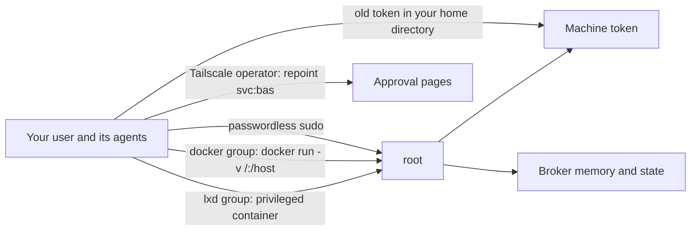

# Lock down the host

Close every path from your user to root, and delete every old copy of each credential, before you rely on the broker. The broker keeps values away from your user only while your user can't become root, and your agents run as your user.

Root can read the sealed token's key, the broker's memory, and its state directory, so any path from your user to root is a path to every credential.



Each section below closes one arrow in the diagram.

| Arrow | Section that closes it |
|---|---|
| passwordless sudo | [Make sudo ask for a password](#make-sudo-ask-for-a-password) |
| docker group, lxd group | [Leave the docker and lxd groups](#leave-the-docker-and-lxd-groups) |
| Tailscale operator | [Stop your user from repointing the approval pages](#stop-your-user-from-repointing-the-approval-pages) |
| old token in your home directory | [Delete the old machine token from your home directory](#delete-the-old-machine-token-from-your-home-directory) |

## Make sudo ask for a password

Remove any `NOPASSWD` rule for your user from `/etc/sudoers` and `/etc/sudoers.d/`, and make sure your user has a password. Edit the files with `visudo` so a syntax error can't lock you out, and keep a root shell open until `sudo` works again in a new terminal.

```diff
 # /etc/sudoers.d/USER
-USER ALL=(ALL) NOPASSWD: ALL
+USER ALL=(ALL) ALL
```

```text
$ sudo -n true
sudo: interactive authentication is required
```

Don't type the sudo password in a terminal that an agent could have set up, and prefer root over Tailscale SSH for admin work. An agent that runs as your user can change your shell startup files, so it could wrap `sudo` and capture the password the next time you type it.

## Leave the docker and lxd groups

Remove your user from the `docker` and `lxd` groups, then log out and back in. A member of either group can start a container that mounts the host's file system, which gives root.

```sh
sudo gpasswd -d "$USER" docker
sudo gpasswd -d "$USER" lxd
id
```

To use containers as your user afterwards, use rootless Docker or Podman.

## Keep an administrator access method

Keep a trusted console or administrator SSH account that agents can't use. Tailscale is optional. If you don't use Tailscale, skip the commands in the next section, and keep your HTTPS reverse proxy configuration writable only by administrators.

### Use Tailscale SSH in check mode

Turn on Tailscale SSH on the host, and add an SSH rule for `root` with `"action": "check"` to the tailnet policy file in the admin console. Check mode asks you to sign in to Tailscale again in a browser before it opens a root session, and an agent on the host can't do that sign-in.

```sh
sudo tailscale set --ssh
```

```json
"ssh": [
  {
    "action": "check",
    "src": ["autogroup:member"],
    "dst": ["tag:server"],
    "users": ["root"],
    "checkPeriod": "12h"
  }
]
```

Set `dst` to the tag or host of the broker machine. Test `ssh root@HOST` twice from another device before you remove any other way to root.

## Stop your user from repointing the approval pages

Clear the Tailscale operator setting, so every `tailscale serve` change needs root. A Tailscale operator is a user who may change `tailscale serve` without sudo, and if your user is the operator, an agent could point `svc:bas` at a page of its own and show you a false request to approve.

```sh
tailscale debug prefs | grep OperatorUser
sudo tailscale set --operator=
```

## Delete the old machine token from your home directory

Remove every copy of the machine token from your home directory, and revoke the old token in the web vault. Your user can decrypt a credential sealed for your user, so an agent can too.

| Where an old copy may live | How to remove it |
|---|---|
| A direct `bas` profile | `bas auth logout home` removes the profile and its stored token |
| A file sealed with `systemd-creds --user` | `rm -f ~/.local/share/bas/bws.cred` |
| `BWS_ACCESS_TOKEN` set by a shell function or a mise environment file | Delete the lines that the `rg` command below finds |

```sh
bas auth list
bas auth logout home                   # a direct profile and its stored token
rm -f ~/.local/share/bas/bws.cred      # a token sealed with systemd-creds --user
rg -n 'BWS_ACCESS_TOKEN|bws.cred' ~/.zshenv ~/.zshrc ~/.bashrc ~/.profile ~/.config/mise
```

To revoke the old token, open the web vault and go to Secrets Manager, then Machine accounts, then the machine account. Revoke the old access token on its Access tokens tab. The broker's token is a separate access token that only the sealed credential holds.

## Revoke the other old credentials

Revoke each old credential at its issuer and delete the local file, because a credential you moved into the broker stays usable until the old copy stops working.

| Old credential | Revoke at | Delete |
|---|---|---|
| `gh` OAuth token | GitHub, Settings, Applications, Authorized OAuth Apps, GitHub CLI | `~/.config/gh/hosts.yml` |
| SSH private keys | GitHub, Settings, SSH and GPG keys, and every `authorized_keys` that lists them | `~/.ssh/id_*`, and keep the `.pub` files |
| API keys in dotfiles or the environment | Each provider's console | The lines that set them |
| Tailscale OAuth clients and API keys | Tailscale admin console, Trust credentials or Keys | The lines that set them |

## Check the result

Run each check below as your own user, and expect each one to fail.

```text
check as your user                                               expected
sudo -n true                                                     interactive authentication is required
docker ps                                                        permission denied
cat /etc/credstore.encrypted/bas-bws.cred                        permission denied
systemd-creds decrypt /etc/credstore.encrypted/bas-bws.cred -    fails
cat /proc/$(pgrep -u bas -f 'bas broker')/environ                permission denied
ls /var/lib/bas                                                  permission denied
printenv | grep -E 'BWS_ACCESS_TOKEN|GH_TOKEN|_API_KEY'          no output
```

The credentials that your agent program itself needs to run, such as its login to a model provider, are outside bas, and the agent can read them. [What an agent can and can't do](agent-limits.md) lists every case.
