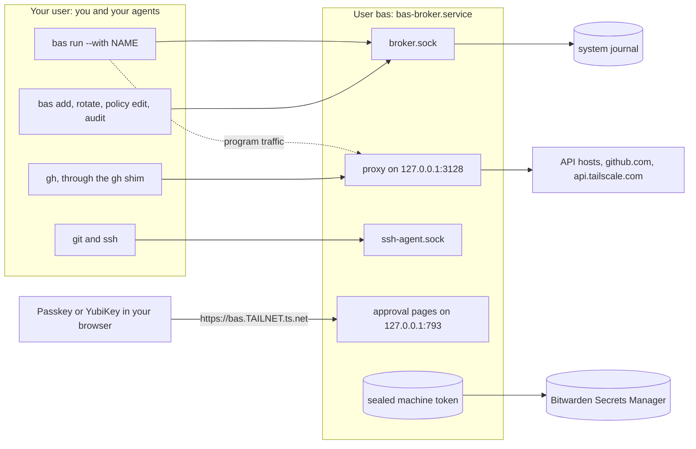
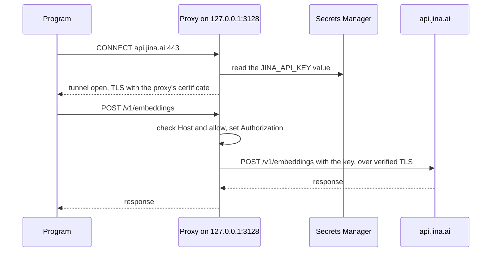
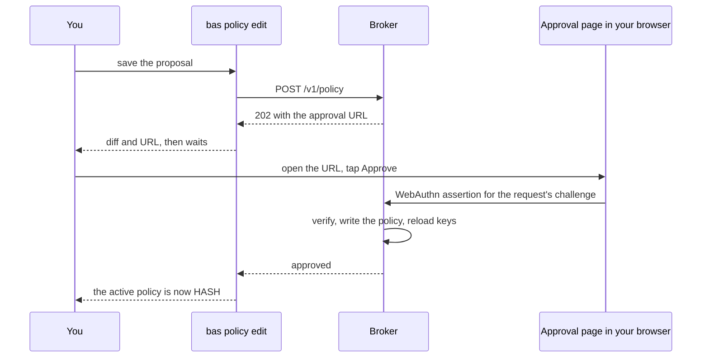

# How the broker works

The `bas` broker runs as a service under a separate system user: a systemd service as `bas` on Linux, or a LaunchDaemon as `_bas` on macOS. It holds the credentials in its policy and uses them for your programs, including coding agents, without handing the values to them. Keeping values from agents also needs the host changes in [Lock down the host](lock-down.md), such as removing old profiles and passwordless `sudo`.

The broker runs on Linux with systemd and on macOS. [macOS and Windows](../platforms.md) lists what differs on macOS. On Windows, use direct access.

## What the broker serves

The broker is one process with four endpoints, and none of them hands out a value.

```text
bas broker (user bas, bas-broker.service)
├── /run/bas/broker.sock       HTTP and JSON API for the bas commands, caller uid checked
├── 127.0.0.1:3128             HTTPS proxy that adds credentials for policy hosts
├── /run/bas/ssh-agent.sock    ssh-agent that signs with policy keys, caller uid checked
└── 127.0.0.1:793              approval pages, published through an HTTPS reverse proxy
```

The socket API and the ssh-agent ask the kernel for the user ID of each caller, and they refuse every user ID that `allow-uids` in `/etc/bas/broker.toml` doesn't list. The proxy and the approval pages listen on loopback addresses only.



## How a program uses a credential

A program uses a credential through the proxy, the ssh-agent, or a minted token. The broker refuses any policy entry that would put a value in a program's environment.

| Credential | How the program uses it |
|---|---|
| API key in a `[secret.NAME]` entry | The program sends HTTPS through the proxy, and the proxy adds the key as a header for one host, on allowed methods and paths only. |
| GitHub App private key | The proxy mints a token for one repository, valid for one hour, and adds it to requests for `api.github.com`, `uploads.github.com`, and `github.com`. |
| Tailscale OAuth client | The proxy mints an access token and adds it to allowed requests for `api.tailscale.com`. |
| SSH key in an `[ssh.NAME]` entry | `ssh` and `git` ask the ssh-agent for a signature. The agent never exports the key. |

The proxy accepts only `CONNECT` to port 443. For a host with no policy entry, it opens a plain tunnel and never reads the traffic. For a policy host, the proxy ends the program's TLS connection with a certificate from its own certificate authority, checks the request, removes any `Authorization` header the program sent, adds its own, and opens a new TLS connection to the real host. The program trusts the proxy's certificate authority through `SSL_CERT_FILE` and similar variables, which point at `/run/bas/ca-bundle.pem`. The authority isn't added to the system trust store.



## How you approve changes

A change to what the broker allows needs your approval with a passkey. A passkey is a WebAuthn key pair kept on a device, such as a YubiKey or a password manager, and each approval needs user verification on the device, such as a touch, a PIN, or Face ID. An agent on the broker machine can't give the verification.

The broker serves the approval pages on `127.0.0.1:793`. An HTTPS reverse proxy publishes them at the configured approval address, and Tailscale Serve is an optional way to do that. Port 793 is below 1024, so no process of your user can take it, even while the broker is down. Each page shows what was asked, the user ID and process ID the kernel reported, and for a policy change the diff.



The following requests need an approval:

- `bas policy edit`, for any change to the policy
- `bas add`, which also asks you to type the new value on the approval page
- `bas rotate NAME` for a `[secret.NAME]` entry, which asks for the new value the same way
- `bas passkey add`, to enroll one more passkey, or `bas passkey add --replace`, to replace all of them

A request waits up to 15 minutes. The broker keeps pending requests in memory, so a restart drops them. Denying a request needs no passkey, because a denial grants nothing.

## What the broker records

The broker writes one entry for each credential it uses, each change, and each refusal. Each entry has the field `BAS_AUDIT=1`. On Linux the entries go to the system journal, and journald adds the unit name itself, so a process of your user can't forge or delete an entry for the broker. On macOS they go to `/var/log/bas/audit.jsonl`, which only the broker can read and only root can shorten. `bas audit` prints the entries.

```text
$ bas audit --since 10m
2026-11-10T22:38:56Z  inject   added github:OWNER/REPO to GET https://api.github.com/repos/OWNER/REPO
2026-11-10T22:38:57Z  sign     signed with ssh key github for uid 1000 (auth)
2026-11-10T22:41:30Z  deny     refused GET https://api.tailscale.com/api/v2/tailnet/-/keys: method and path not in api_allow
```

## Next steps

Follow [Install the broker](install.md), then add a [GitHub App](github-app.md) and a [Tailscale OAuth client](tailscale.md) if you need them. [Lock down the host](lock-down.md) explains what else must be true for an agent to have no way to the values.
