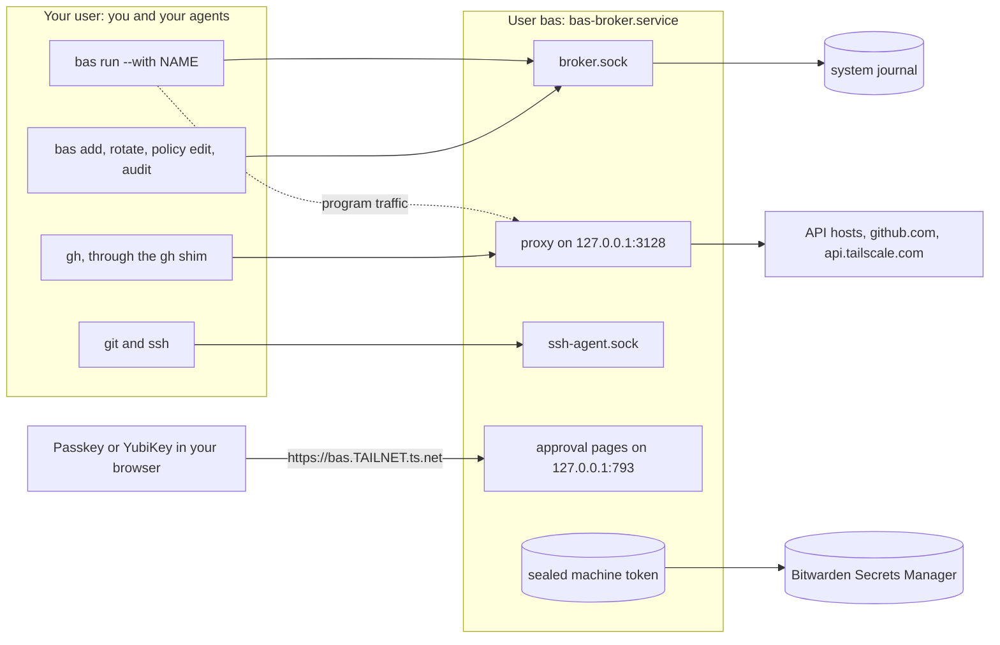
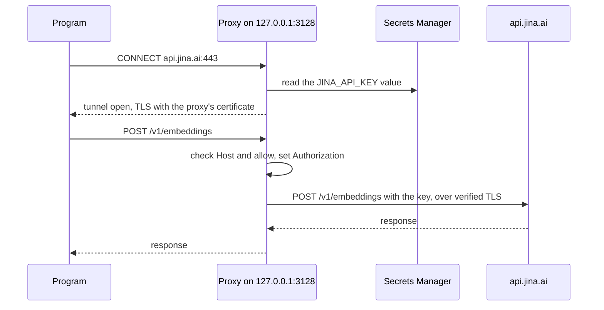
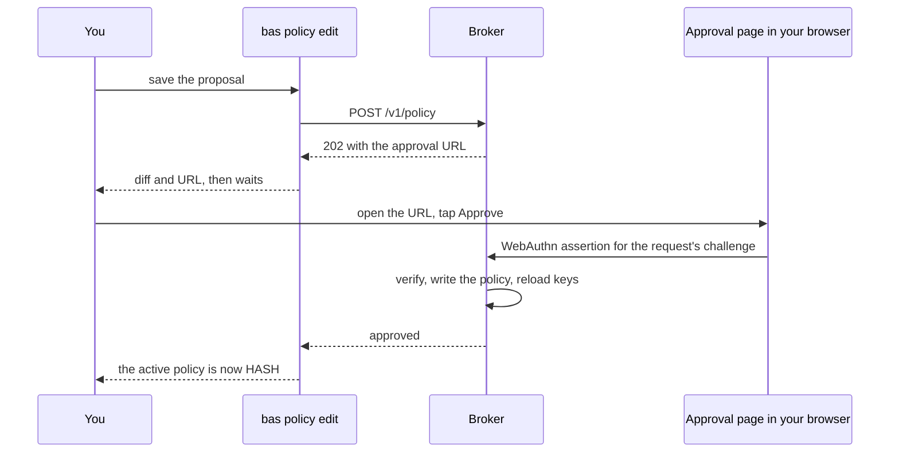

# How the broker works

Run the `bas` broker when you want your programs and coding agents to use credentials without ever holding their values, and follow [Install the broker](install.md) to set it up. The broker runs as a service under its own system user, holds the credentials in its policy, and uses them on behalf of your programs.

| Platform | How the broker runs |
|---|---|
| Linux with systemd | The systemd service `bas-broker.service`, as the user `bas` |
| macOS | A LaunchDaemon, as the role account `_bas`. [macOS and Windows](../platforms.md) lists what differs. |
| Windows | No broker. Use direct access. |

The broker alone doesn't keep values from agents. You also need the host changes in [Lock down the host](lock-down.md), such as removing old profiles and passwordless `sudo`.

## What the broker serves

The broker is one process with four endpoints, and none of them hands out a value.

```text
bas broker (user bas, bas-broker.service)
├── /run/bas/broker.sock       HTTP and JSON API for the bas commands, caller uid checked
├── 127.0.0.1:3128             HTTPS proxy that adds credentials for policy hosts
├── /run/bas/ssh-agent.sock    ssh-agent that signs with policy keys, caller uid checked
└── 127.0.0.1:793              approval pages, published through an HTTPS reverse proxy
```

On macOS the sockets live in `/var/run/bas/`, and the approval pages listen on the socket `/var/run/bas/approve.sock` instead of a port.

The socket API and the ssh-agent ask the kernel for the user ID of each caller. They refuse every user ID that `allow-uids` in `/etc/bas/broker.toml` doesn't list. The proxy and the approval pages listen on loopback addresses only.



## How a program uses a credential

A program uses a credential through the proxy, the ssh-agent, or a minted token, and the broker refuses any policy entry that would put a value in a program's environment.

| Credential | How the program uses it |
|---|---|
| API key in a `[secret.NAME]` entry | The program sends HTTPS through the proxy, and the proxy adds the key as a header for one host, on allowed methods and paths only. |
| GitHub App private key | The proxy mints a token for one repository, valid for one hour, and adds it to requests for `api.github.com`, `uploads.github.com`, and `github.com`. |
| Tailscale OAuth client | The proxy mints an access token and adds it to allowed requests for `api.tailscale.com`. |
| SSH key in an `[ssh.NAME]` entry | `ssh` and `git` ask the ssh-agent for a signature. The agent never exports the key. |

The proxy reads only the traffic for hosts in the policy, and it passes all other traffic through unread.

```text
on(request to the proxy)
  if not CONNECT to port 443
    refuse
  if host has no policy entry
    open a plain tunnel, never read the traffic
  else
    end the program's TLS with a certificate from the proxy's own certificate authority
    check the request
    remove any Authorization header the program sent, add its own
    open a new TLS connection to the real host
```

The program trusts the proxy's certificate authority through `SSL_CERT_FILE` and similar variables, which point at `/run/bas/ca-bundle.pem`. The broker doesn't add the authority to the system trust store.



## How you approve changes

You approve each change to what the broker allows with a passkey. A passkey is a WebAuthn key pair kept on a device, such as a YubiKey or a password manager. Each approval needs user verification on the device, such as a touch, a PIN, or Face ID, and an agent on the broker machine can't give it.

The broker serves the approval pages on `127.0.0.1:793`, and an HTTPS reverse proxy publishes them at the configured approval address. Tailscale Serve is an optional way to publish them. Port 793 is below 1024, so no process of your user can take it, even while the broker is down. Each page shows what was asked and the user ID and process ID the kernel reported, and for a policy change it also shows the diff.



The table lists each request that needs an approval.

| Command | What you approve |
|---|---|
| `bas policy edit` | Any change to the policy |
| `bas add` | A new secret, whose value you type on the approval page |
| `bas rotate NAME` for a `[secret.NAME]` entry | A new value, which you type on the approval page the same way |
| `bas passkey add` | One more passkey |
| `bas passkey add --replace` | New passkeys that replace all of the enrolled ones |

A request waits up to 15 minutes. The broker keeps pending requests in memory, so a restart drops them. Denying a request needs no passkey, because a denial grants nothing.

## What the broker records

The broker writes one audit entry for each credential it uses, each change, and each refusal, and `bas audit` prints the entries. Each entry has the field `BAS_AUDIT=1`.

| Platform | Where the entries go | Who can change them |
|---|---|---|
| Linux | The system journal, where journald adds the unit name itself | No process of your user can forge or delete an entry for the broker |
| macOS | `/var/log/bas/audit.jsonl` | Only the broker can read the file, and only root can shorten it |

```text
$ bas audit --since 10m
2026-11-10T22:38:56Z  inject   added github:OWNER/REPO to GET https://api.github.com/repos/OWNER/REPO
2026-11-10T22:38:57Z  sign     signed with ssh key github for uid 1000 (auth)
2026-11-10T22:41:30Z  deny     refused GET https://api.tailscale.com/api/v2/tailnet/-/keys: method and path not in api_allow
```

## Next steps

Follow [Install the broker](install.md) first. Then add a [GitHub App](github-app.md) and a [Tailscale OAuth client](tailscale.md) if you need them. [Lock down the host](lock-down.md) explains what else must be true so an agent has no way to reach the values.
