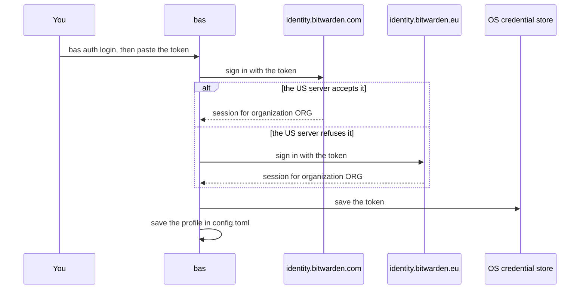

# Sign in with an access token

Run `bas auth login` and paste the access token of a Secrets Manager machine account, and `bas` saves a profile that the other commands use.

A machine account is a Secrets Manager identity for programs, and you give it access to the projects it may read or write. Create one in the Bitwarden web vault under Secrets Manager, then Machine accounts, and create an access token on its Access tokens tab.

## Sign in

Paste the token when `bas auth login` asks. `bas` hides what you paste, and it saves the profile only after Secrets Manager accepts the token.

```sh
bas auth login           # paste the token, then press Enter
bas auth status default  # signs in again and reports the organization and endpoint
```

The profile is called `default` unless you give a name, as in `bas auth login work`. `bas tui` does the same sign-in on its first screen when no profile exists yet, and then it shows your projects and secrets.

`bas` finds the server and the organization by itself. The token holds an ID, a client secret, and a key, and it names no organization and no server, so `bas` asks bitwarden.com first and then bitwarden.eu, and the server that accepts the token names the organization in its answer.



## Pin the answer with flags

Add a flag to name the organization, the region, or the server yourself. `bas` still refuses a token of another organization.

| Flag | What it does |
|---|---|
| `--organization <UUID>` | Requires the token to belong to the organization |
| `--region us` or `--region eu` | Uses bitwarden.com or bitwarden.eu only |
| `--server-url <URL>` | Uses a self-hosted server at `URL/api` and `URL/identity` |
| `--api-url <URL> --identity-url <URL>` | Uses two explicit endpoints |
| `--clipboard` | Reads the token from the clipboard |
| `--stdin` | Reads the token from piped stdin |
| `--from-env` | Stores nothing and reads `BWS_ACCESS_TOKEN` at every use |

## Keep the token safe

Never pass a token as an argument, and never paste a token into an agent transcript. `bas` stores the token as the pseudocode shows, and it never falls back to a plain text file.

```text
on(bas auth login)
  if --from-env
    store nothing
    read only BWS_ACCESS_TOKEN at each use
  else                                  pasted, --clipboard, or --stdin
    if the OS credential store is available
      save the token there
    else
      fail the sign-in
```

On a server without a desktop session, have your existing secret delivery set `BWS_ACCESS_TOKEN`, and sign in with `bas auth login --from-env`.

## Where bas keeps its settings

`bas` keeps profiles in a `bas` directory inside the user configuration directory, which is `~/.config/bas` on Linux. Set `BAS_CONFIG_DIR` to use another absolute path outside every Git repository.

```text
~/.config/bas/       # or the path in BAS_CONFIG_DIR, mode 0700
├── config.toml      # profiles and paired device fingerprints
├── grants.toml      # grants for paired devices
├── helpers.toml     # references that bas get may print
├── policy.lock      # orders changes to grants and profiles
└── policy.toml      # broker policy proposal, on a broker host only
```

The directory must be private to its owner, and `bas` refuses one that grants any permission to the group or to others. Machine tokens and Agent Access keys never go into the configuration directory.

## Check readiness

Run `bas doctor` to see what is set up. It contacts no server unless you add `--profile` or `--broker`.

```sh
bas doctor                    # offline
bas doctor --profile default  # also signs in and confirms the organization
bas doctor --broker           # on a broker host, three more checks
```

| Check from `--broker` | Ready means |
|---|---|
| `git signing` | A disposable commit was signed through the bas shim with this repository's Git settings, and `git verify-commit` trusts it. No ref, index, hook, or setting changes. |
| `broker compatibility` | This client read the broker's status and displayed its policy. |
| `policy references` | The broker's machine account can see every reference in the broker's policy. No value is read. |

Each check prints the evidence it gathered under its line, and a `fix:` line when there is something to do. `bas doctor` never applies a fix, and `--json` prints the same results as one JSON line.

```text
exit code of bas doctor
  0   no check failed or warned
  1   a check failed
  2   a check warned and none failed
```

A check reports `warning` when it can't gather its evidence, e.g., when the broker is unreachable or the signing key needs a hardware touch.

If a step fails, [First-run messages](../reference/first-run.md) lists every message `bas` can print before the first secret, what it most likely means, and the command to type next.
