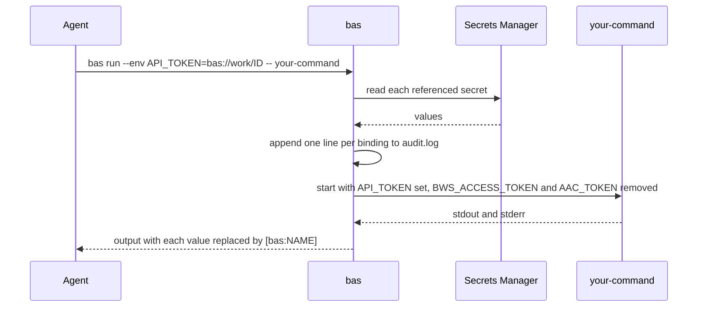

# Find and use secrets

Find a secret's reference with `bas find`, and pass the reference to `bas run`, so the value never appears in the agent's commands or in its transcript.

## Find a reference

Run `bas find` with a fragment of the key, and it prints the reference of each secret whose key contains the fragment. It never prints values or notes.

```sh
bas find --profile work API
bas find --profile work --project <project-id> --json
```

```text
$ bas find --profile work --json API
{"matches":[{"reference":"bas://work/<secret-id>","key":"API_TOKEN","project_ids":["<project-id>"],"matched":["API"],"duplicate_key":false}],"unmatched":[]}
```

The search ignores case. Without a fragment, `bas find` lists every secret the machine account can read, and a fragment that matches nothing appears under `unmatched`.

## Run a program with secrets

Bind each reference to a variable name with `--env`, and `bas run` starts the program with the values in those variables.

```sh
bas run --env "API_TOKEN=bas://work/<secret-id>" -- your-command --flag
```



`bas run` follows the steps below, and it stops before the program starts when a step fails.

```text
bas run --env NAME=REFERENCE -- program args
  read every referenced secret              any failure: the program doesn't start
  append one JSON line per binding to audit.log
    the line holds the time, the variable name, the reference,
    the program name, the working directory, and the process ID, never a value
    write fails: the program doesn't start
  build the environment
    remove BWS_ACCESS_TOKEN and AAC_TOKEN
    keep every other variable of your environment
  start the program with the arguments after --, without a shell
  replace each injected value of 4 or more bytes with [bas:NAME] in stdout and stderr
```

`bas` writes `audit.log` in `BAS_STATE_DIR`, or in the user state directory when the variable isn't set.

```text
$ bas run --env "API_TOKEN=bas://work/<secret-id>" -- sh -c 'echo "$API_TOKEN"'
[bas:API_TOKEN]
```

Masking guards against accidents in a transcript, and it doesn't sandbox the program. The program can still write a value to a file, send it over the network, or print it in another encoding, e.g., base64, so pick the program with care. To keep values away from an agent on purpose, use [the broker](../broker/overview.md).

## Give one secret to a credential helper

Allow a reference with `bas helper allow`, and `bas get` prints its raw value for a tool that reads one secret from a command's stdout.

Such tools include pi's `"!cmd"` keys in `auth.json`, git credential helpers, and `apiKeyHelper`. `bas run` masks stdout, so it can't serve them. `bas get` prints the value with no trailing newline.

```sh
bas helper allow bas://work/<secret-id>   # asks you to type a one-time code
bas helper list
bas helper revoke bas://work/<secret-id>
```

```json
"managementKey": "!bas get bas://work/<secret-id>"
```

`bas get` decides as the pseudocode shows.

```text
on(bas get REFERENCE)
  if stdout is a terminal
    refuse, so the value never shows on screen
  if this machine has a bas broker
    ask the broker, which answers only for a [helper.NAME] entry of its policy
  else if REFERENCE isn't on the helper list
    refuse                               bas run keeps other references masked
  if REFERENCE belongs to a remote profile
    it still needs approval or a grant on the listener
  append one JSON line to audit.log with the reference, the parent process,
    and the working directory, never the value
    write fails: print nothing
  print the value
```

On a machine with a [bas broker](../broker/overview.md), the broker holds the machine token, so the list that `bas helper allow` keeps has no effect there.

| Command | Without a broker | With a broker |
|---|---|---|
| `bas get` | Reads the value for a reference on the local list | Asks the broker, which answers only for references in a [`[helper.NAME]`](../broker/policy.md#helpername) entry |
| `bas helper list` | Lists the local list | Lists the `[helper.NAME]` entries |
| `bas helper allow`, `bas helper revoke` | Change the local list | Refuse |
| Add a reference | `bas helper allow` | `bas policy edit`, which your passkey approves |

## Keep bindings in a template

Write your bindings to a reference template with `bas env write`, and run a program with them with `bas env run`, which follows the same rules as `bas run`.

```sh
bas env write .env.refs --env "API_TOKEN=bas://work/<secret-id>" --env "DB_URL=bas://work/<secret-id>"
bas env run .env.refs -- your-command
```

```text
# .env.refs
API_TOKEN=bas://work/<secret-id>
DB_URL=bas://work/<secret-id>
```

A template holds `NAME=bas://profile/id` bindings, comments, and blank lines only. It can't hold plain text values, shell commands, or substitutions, and `bas` expands nothing in it. `bas env write` refuses to replace an existing file unless you add `--force`.

A template holds no secret, but before you commit one, decide whether you want its secret IDs in version control.
