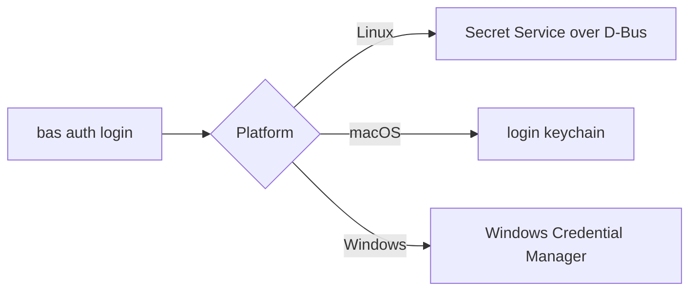

# macOS and Windows

Use direct access and Agent Access on any platform, and run the broker on Linux or macOS, because Windows has no broker.

| Feature | Linux | macOS | Windows |
|---|---|---|---|
| `bas auth`, `find`, `run --env`, `get`, `helper`, `env`, `create`, `update`, `tui`, `doctor` | yes | yes | yes |
| `bas listen`, `pair`, `grant` (Agent Access) | yes | yes | yes |
| `bas broker`, `add`, `rotate`, `policy`, `audit`, `passkey`, `mcp` | yes | yes | no |
| `bas run --with`, `bas tui --broker`, `bas doctor --broker` | yes | yes | no |

```text
bas --help on Windows
  auth, find, run, get, helper, env, create, update, doctor, listen, pair, grant, tui
  (no broker, add, rotate, policy, audit, passkey, or mcp)
```

## The broker on macOS

Install the macOS broker from `contrib/macos/`, and it serves the same socket API, proxy, ssh-agent, and approval pages as the Linux broker. The parts in the table differ, because macOS has no systemd and no journal.

| Part | Linux | macOS |
|---|---|---|
| Service | systemd unit, user `bas` | LaunchDaemon, role account `_bas` |
| Machine token | sealed with `systemd-creds` | the file `/var/db/bas/credentials/bws`, readable only by `_bas` |
| Audit record | the system journal | `/var/log/bas/audit.jsonl`, append-only, read through the broker |
| Approval pages | `127.0.0.1:793` | the socket `/var/run/bas/approve.sock`, published with `tailscale serve` |
| Sandbox | systemd's `Protect*` options | none, so the separate user is the only protection |

Keep your daily account a standard user on macOS, and read the other limits in the table.

| Limit on macOS | What follows |
|---|---|
| The broker keeps values from your user only while your user isn't an administrator. | An administrator's password gives root, and an agent that runs as you can capture it or wait for a Touch ID or security key touch at a `sudo` prompt. Make your daily account a standard user, as [Install the broker](broker/install.md#install-on-macos) describes. |
| `gh` on macOS honors `SSL_CERT_FILE`. | The macOS install ships the same `gh` shim as Linux. |
| No firewall rule limits the proxy port to your user. | Any local account can send requests through it, and the policy still decides what each request may do. |

## Where the token lives

`bas auth login` saves the machine token in the credential store of the operating system.



On macOS, a locked keychain makes the sign-in fail with a message that names it, so run `security unlock-keychain` and try again.

Every macOS release is signed with the same certificate under the identifier `dev.bas`, so an answer of "Always Allow" lasts across upgrades. A build you compile yourself isn't signed with it, and the keychain asks about that build again.

## What direct access protects

Use a machine account that can read only the projects an agent needs, and keep high-value credentials on a broker host instead.

With direct access, `bas run` puts each value in the program's environment, so an agent that controls the program can read the value. Masking hides values in the program's output, and it doesn't stop a program that wants the value.
