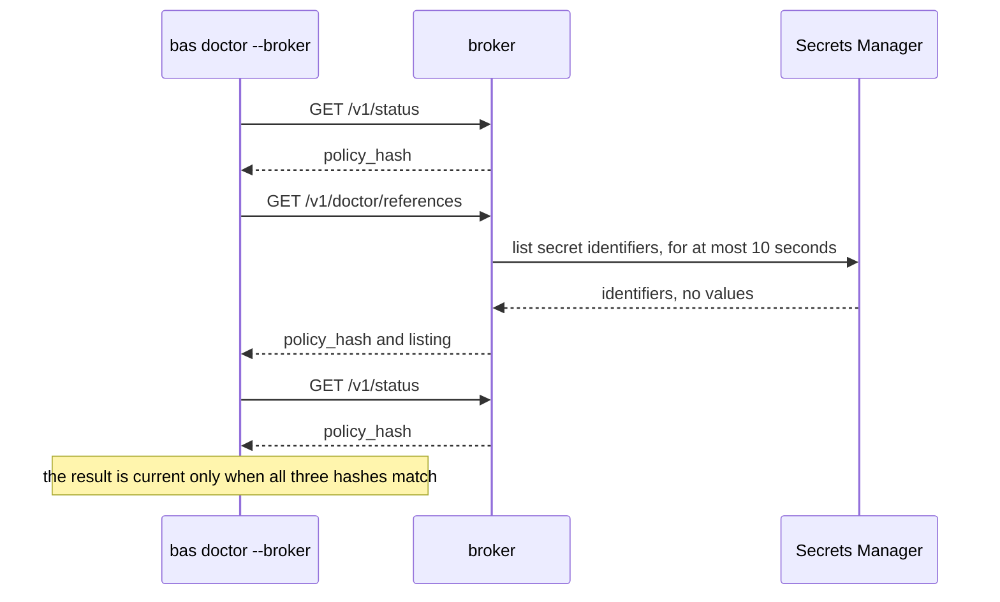

# Broker socket replies

Read the four state replies on this page, `GET /v1/status`, `GET /v1/policy`, `GET /v1/doctor/references`, and `GET /v1/passkeys`, when you write a client that shows the broker's state. `bas` and `bas tui` talk to the broker over its unix socket with HTTP and JSON. A client and a broker of different versions must keep working together, so the four state replies are a stable contract.

## Routes

The broker serves the routes below on `/run/bas/broker.sock` on Linux and `/var/run/bas/broker.sock` on macOS. It answers a caller whose uid isn't in `allow-uids` with `403` and `{"error": "peer not allowed"}`.

| Method and path | Used by | Reply |
|---|---|---|
| `GET /v1/status` | clients that show state | Version, policy hash, and pending requests, described below |
| `GET /v1/policy` | clients that show state | Active policy text and entries, described below |
| `GET /v1/doctor/references` | `bas doctor --broker` | Visibility of each policy reference, described below |
| `GET /v1/passkeys` | `bas passkey list` | Enrolled passkeys, described below |
| `POST /v1/run` | `bas run --with` | `names` and `proxy` with `url` and `ca_bundle`, never a value |
| `POST /v1/helper` | `bas get` | `name` and `value` of a `[helper.NAME]` entry, the only reply that holds a secret value |
| `POST /v1/secrets` | `bas add` | `202` with an approval |
| `POST /v1/secrets/{name}/rotate` | `bas rotate` | `202` with an approval for a stored value, or `{"rotated": "minted"}` for `github` and `tailscale` |
| `POST /v1/policy` | `bas policy edit` | `202` with an approval and a `diff`, or `{"unchanged": true}` |
| `POST /v1/passkeys` | `bas passkey add` | `202` with an approval |
| `GET /v1/approvals/{id}?wait=SECONDS` | clients that wait for an approval | `state`, which is `pending`, `approved`, `denied`, `expired`, or `failed`, with `result` or `error` when there is one. The wait lasts at most 300 seconds. |
| `GET /v1/audit` | `bas audit` on macOS | `entries`, one JSON object per audit entry, oldest first. macOS only. |

A route that needs a passkey approval answers `202` with the body below.

```json
{ "approval": { "id": "8f0c...", "url": "https://.../a/8f0c..." }, "diff": "..." }
```

A refused request gets an error status and a body with `error`. `error` is `denied` when the policy refuses the request, and a short reason otherwise. `name` appears when the refusal is about a policy name, and `line` appears when a proposed policy has an error on that line. The example below is the reply to `POST /v1/run` for a name that isn't a proxy entry.

```json
{ "error": "denied", "name": "JINA_API_KEY" }
```

## Compatibility rules

A client must accept every reply that the rules below allow.

- A reply only gains fields. No field is removed or renamed, and no field changes type.
- A client ignores fields it does not know.
- A field added after 0.8.6 may be missing from an older broker's reply. A client treats a missing field as empty.
- A client shows an entry `kind` that it does not know by its generic fields (`name`, `hint`, `about`, `facts`, `use`, `references`), and never refuses it.

## GET /v1/status

The status reply gives the broker's version, the hash of its active policy, and the requests that wait for a passkey approval.

```json
{
  "version": "0.9.1",
  "policy_hash": "234a60d414c9...",
  "requests": [
    {
      "id": "8f0c...",
      "kind": "rotate",
      "subject": "JINA_API_KEY",
      "peer_uid": 1000,
      "created_at": "2026-11-14T13:25:58Z",
      "expires_in": 840,
      "url": "https://.../a/8f0c..."
    }
  ]
}
```

| Field | Meaning |
| --- | --- |
| `version` | Version of the running broker. |
| `policy_hash` | SHA-256 of the active policy text, in lowercase hex. It changes when the policy changes. |
| `requests` | Requests that wait for a passkey approval. `kind` is `add`, `rotate`, `policy`, or `passkey`. |
| `requests[].subject` | The policy name for `add` and `rotate`, and the proposed policy's hash for `policy`. |
| `requests[].peer_uid` | User ID of the client that asked. |
| `requests[].created_at` | When the client asked, in RFC 3339. |
| `requests[].expires_in` | Seconds until the request expires. |
| `requests[].url` | Approval page to open in a browser. |

## GET /v1/policy

The policy reply gives the active policy text and the broker's own description of each entry, so a client never needs to parse the policy format.

```json
{
  "hash": "234a60d414c9...",
  "toml": "version = 1\n...",
  "entries": [
    {
      "kind": "secret",
      "name": "JINA_API_KEY",
      "hint": "api.jina.ai",
      "about": [
        "The broker adds this key to requests to api.jina.ai.",
        "It refuses every other request, and the program never sees the key."
      ],
      "facts": [{ "label": "Allowed", "value": "POST /v1/*" }],
      "use": "bas run --with JINA_API_KEY -- CMD",
      "references": [{ "label": "", "value": "bas://home/<secret-id>" }],
      "details": [
        { "label": "ref", "value": "bas://home/<secret-id>" },
        { "label": "host", "value": "api.jina.ai" }
      ]
    }
  ]
}
```

| Field | Meaning |
| --- | --- |
| `hash` | SHA-256 of `toml`, in lowercase hex. |
| `toml` | The active policy text, as `bas policy edit` starts from it. |
| `entries` | The broker's own description of each entry, added after 0.8.6. A client shows these instead of reading `toml`, so it never needs to know the policy format of a newer broker. |

A client picks its source of entries by the rule below.

```text
on(GET /v1/policy reply)
  if entries is present
    show entries
  else
    the broker is 0.8.6 or older, so read toml itself
```

Each entry has the fields below. An entry names where values live, and never holds a value.

| Field | Meaning |
| --- | --- |
| `kind` | `secret` (an API key the proxy adds), `helper` (a value `bas get` prints), `ssh`, `github`, or `tailscale`. Newer brokers may send other kinds. |
| `name` | The policy name, which `bas rotate` takes. |
| `hint` | A few words for a list row, such as the host an API key is sent to. |
| `about` | Sentences that say what the entry lets a program do. |
| `facts` | The entry's rules in plain words, as label and value pairs in order. |
| `use` | How a program uses the entry. |
| `references` | The `bas://` references of the stored values. A label names each one when there are several. |
| `details` | The entry's policy settings by their keys, as `bas policy show --json` prints them. |

## GET /v1/doctor/references

`bas doctor --broker` asks whether the broker's machine account can see each reference of the active policy. The broker lists secret identifiers only, and never reads a value for the answer. A broker without the endpoint answers `404`.



```json
{
  "policy_hash": "234a60d414c9...",
  "listing": {
    "outcome": "listed",
    "references": [
      {
        "reference": "bas://home/<secret-id>",
        "locations": ["secret.JINA_API_KEY.ref", "helper.JINA_API_KEY.ref"],
        "visible": true
      }
    ]
  }
}
```

| Field | Meaning |
| --- | --- |
| `policy_hash` | SHA-256 of the policy text whose references were checked. A client compares it with `policy_hash` from `GET /v1/status` before and after. |
| `listing.outcome` | What the identifier listing established. See the next table. |
| `listing.references` | Each distinct reference with every policy key that holds it. Only `listed` adds `visible`. `not_needed` has no list. |

| `outcome` | Meaning |
| --- | --- |
| `listed` | A nonempty listing finished. `visible` says whether it held each reference. |
| `empty` | The listing succeeded with no identifiers. The SDK cannot tell that from a reply without the list, so visibility is unknown. |
| `failed` | Secrets Manager refused the listing or could not be reached. The broker logs the reason. |
| `timed_out` | The listing did not finish within 10 seconds. |
| `policy_changed` | The active policy changed while the listing ran. |
| `not_needed` | The policy names no reference, so the broker asked Secrets Manager nothing. |

A newer broker may send another `outcome`, and a client reports it as unknown instead of refusing the reply. A reference missing from a `listed` result is not visible to the machine account. It may be deleted or hidden by project access, and the two look the same.

## GET /v1/passkeys

The passkeys reply lists the enrolled passkeys, oldest first, without their keys. An empty list means no passkey can approve a change yet.

```json
{ "passkeys": [{ "label": "laptop", "added": "2026-11-14T13:25:58Z" }] }
```

| Field | Meaning |
| --- | --- |
| `label` | The name given when the passkey was enrolled. |
| `added` | When the passkey was enrolled, in RFC 3339. |
