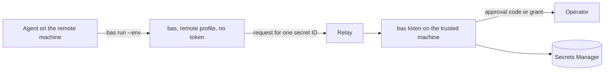
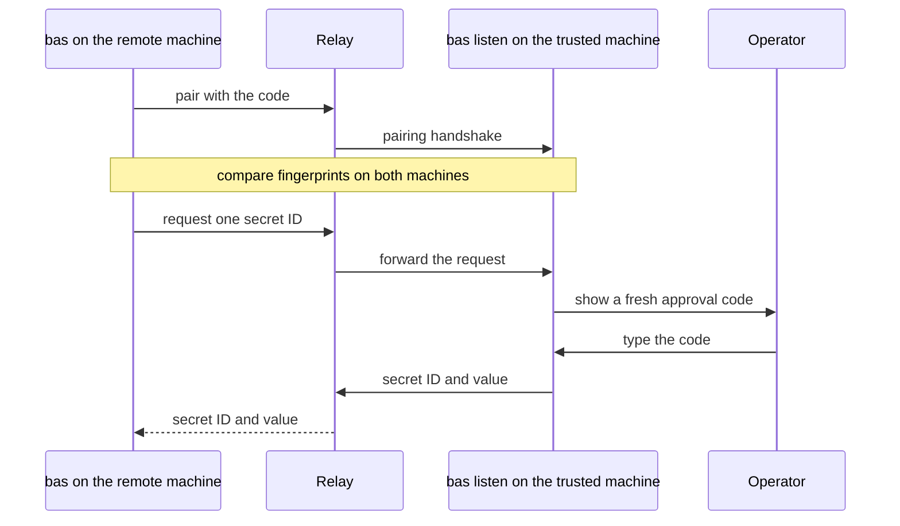

# Pair a remote machine with Agent Access

Run `bas listen` on a trusted machine and `bas pair` on a remote machine, so `bas` on the remote machine can use secrets without holding a machine token. The remote machine asks the listener for each secret, and the operator of the trusted machine approves each request, or a [grant](grants.md) approves it.

Agent Access is an experimental Bitwarden protocol that sends credentials between paired machines through a relay server.



Both machines need a working OS credential store for the identity and session keys. A machine token in the environment doesn't replace the credential store.

## Choose a relay

Choose and approve a relay before you expose a listener beyond local testing, because the `bas` project doesn't run a relay.

| Relay address | Accepted |
|---|---|
| `wss://HOST` | Yes, and use it for a remote relay |
| `ws://` to a loopback address | Yes |
| `ws://` to any other address | No |

## Start the listener and pair

First, sign in on the trusted machine with a direct profile, as [Sign in with an access token](../getting-started/first-run.md) shows. Second, start the listener with the secret IDs that remote devices may ask for, and with `--pair` to accept one new device.

```sh
bas listen --profile work --relay wss://<relay-host> --allow <secret-id> --allow <secret-id> --pair --peer-name build-host
```

| Option | Meaning |
|---|---|
| `--profile` | Direct profile whose Secrets Manager access the listener uses |
| `--relay` | The relay, as `wss://HOST`, or `ws://` to a loopback address |
| `--allow` | A secret ID that remote devices may ask for. Repeat it for more IDs. |
| `--pair` | Shows a pairing code on the terminal and accepts one new device |
| `--peer-name` | Label for the device that `--pair` pairs |

Third, pair the remote machine with the listener. `bas pair` asks for the code that the listener shows, and then for the handshake fingerprint, so compare the fingerprints on both machines before you confirm.

```sh
bas pair remote --relay wss://<relay-host>
bas run --env "API_TOKEN=bas://remote/<secret-id>" -- your-command
```

Type the pairing code in the terminal that controls the remote program, and keep pairing material out of logs and agent transcripts.



## How the listener decides

A paired device gets a secret only when the operator types a fresh code that the listener shows for the exact request, or when an active grant covers it. Pairing lets a device ask for secrets, and it doesn't give the device access.

```text
on(request from a paired device)
  if it is a domain or search request
    deny
  if the secret ID is outside --allow
    deny
  if the grant file is malformed
    deny
  if an active grant covers the device, profile, organization, and secret ID
    deliver
  else if the listener has a terminal
    ask the operator to type a fresh code
  else
    deny
```

The listener reads the value from Secrets Manager only after the approval, and it checks the pairing, the profile, and the grant again on disk before it releases each reply. It writes status lines to stderr and never prints a value.

`bas run` requests each reference separately, and one failed request stops the program from starting. A remote profile can't find, create, or update secrets, and a remote failure never falls back to a machine token.

The listener puts the secret ID in the credential ID field of the Agent Access response and the value in the password field, and it leaves the other fields empty.

## Limits of the pinned SDK

Restart the listener or pair again to recover a device after a failed session replacement handshake. When such a handshake fails verification, the listener refuses the device and drops any queued replies for it.

The pinned Agent Access SDK also doesn't keep replay nonces across a restart, so each delivery has to pass the current checks again. A replay nonce is a one time value that stops an old message from being accepted twice.

## Remove a remote profile

Run `bas auth logout <profile>` on the remote machine to remove a remote profile and its pairing. On the trusted machine, `bas auth logout` of the direct profile removes its paired devices and revokes its grants.

```text
bas auth logout remote     on the remote machine     removes the remote profile and its pairing
bas auth logout work       on the trusted machine    removes the direct profile, its paired devices, and its grants
```

Neither command deletes any secret in Secrets Manager.
