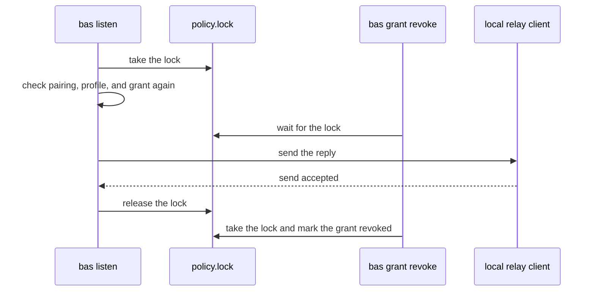

# Grants

Run `bas grant add` on the trusted machine to let a listener deliver exact secrets to one paired device without asking the operator, and run `bas grant revoke` to stop it. A grant stays active until you revoke it, and it can't widen the `--allow` list of the listener or pair a device.

```sh
bas auth list                                     # shows paired device fingerprints
bas grant add --profile work --device <paired-fingerprint> --secret <secret-id>
bas grant list --profile work --json
bas grant revoke <grant-id>
```

Each grant ties one paired device fingerprint to a profile, that profile's organization, and exact secret IDs. You create grants only on the trusted machine, and `bas` keeps them in `grants.toml` in the bas configuration directory.

```text
grants.toml
└── grant <grant-id>
    ├── state         active or revoked
    ├── device        <paired-fingerprint>
    ├── profile       work
    ├── organization  <organization-id>
    └── secrets       [<secret-id>, ...]
```

| Command | Prints |
|---|---|
| `bas grant add` | The grant as one JSON line, or an identical active grant instead of a duplicate |
| `bas grant list` | Active and revoked grants as text lines, or `{"grants":[...]}` with `--json`. `--profile` keeps only one listener profile's grants. |
| `bas grant revoke` | The grant as one JSON line, after the revocation is on disk |

Revoke every grant that allows a secret to remove a device's access to it, because different grants that overlap stay separate. A malformed grant file makes the listener deny every delivery.

## How revocation waits for deliveries

A revocation that succeeds always waits for any delivery that has already started. The listener holds a lock on `policy.lock` from the moment it checks the pairing, the profile, and the grant again until the local relay client accepts the reply, and `bas grant revoke` takes the same lock.



Rotate the secret if a device should lose it for good, because a revocation can't erase a value the remote machine already has. The send result confirms only that the local relay client accepted the reply, so a reply queued before a revocation can still arrive after it.

The listener withholds a reply that stays queued past its request deadline, and it then denies the device until the listener restarts.
