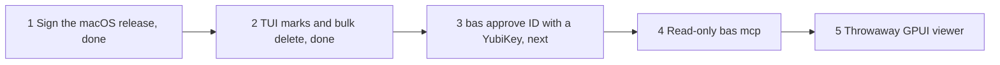
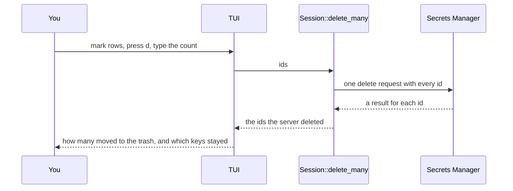
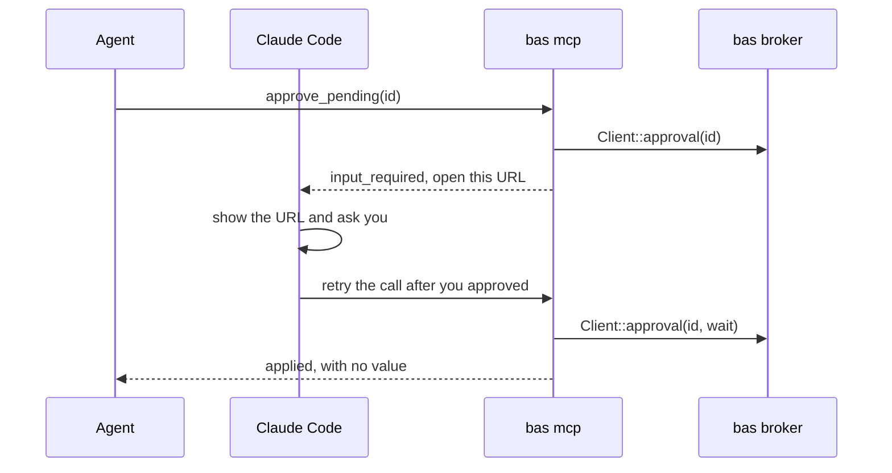

# bas next steps

The brief covers four topics for later work: the TUI, a GUI with GPUI Kit, simpler approvals, and MCP. It was written on 14 Nov 2026 against bas 0.8.7, updated on 15 Nov 2026 after steps 1 and 2 were built, and deepened on 16 Nov 2026 with approval evidence and acceptance criteria.

## Where the work stands

Steps 1 and 2 are on `main`, so don't build them again. The next step to start is step 3.



| Order | Step | Status | Commit |
|---|---|---|---|
| 1 | Sign the macOS release | Done on 15 Nov 2026 | `ef8c596`, `3ec9248` |
| 2 | Marks and bulk delete in the TUI | Done on 15 Nov 2026 | `8bd27ee` |
| 3 | `bas approve ID` signed by a YubiKey | Investigated; implementation awaits trust decisions | |
| 4 | Read-only `bas mcp` | Not started | |
| 5 | GPUI broker viewer | Not started | |

```text
left over from steps 1 and 2
├── release       no release is signed yet, because 0.8.7 was built before step 1
├── measure       keychain prompts across two upgrades, after two signed releases exist
├── TUI           the "bas: plain" note marker, see the TUI section
└── TUI           the case where the server deletes only some marked secrets was never run
```

## Keychain pop-ups

Status: done. The macOS job in `.github/workflows/ci.yml` signs `bas` with one self-signed certificate, so every release has the same signing identity.

The pop-ups came from how the release was signed. An ad hoc signature names a program by the hash of its code, and the hash changes with every release.

```diff
 codesign -d -r- bas
-  designated => cdhash H"cfab20a6..."
+  designated => identifier "dev.bas" and certificate leaf = H"b462b050..."
```

The first plan was a Developer ID, which needs a paid Apple Developer account. A test on the mini (macOS 27.2.1) showed that a self-signed certificate is enough, so no account was bought.

```text
test on the mini, in a throwaway keychain
  build 1 writes an item, build 2 reads it
  both ad hoc                        refused, status -25293
  both signed with one certificate   allowed, status 0
```

```text
Sign the macOS executable  (ci.yml, macOS only)
  write the secret MACOS_SIGNING_IDENTITY to a file
  create a keychain and import the key and certificate
  put the keychain on the search list
  codesign --sign <certificate hash> --identifier dev.bas target/release/bas
  delete the keychain
  fail unless the signature names dev.bas and the certificate
```

| Fact | Effect |
|---|---|
| The key and certificate exist only in the GitHub secret `MACOS_SIGNING_IDENTITY` | A lost secret needs a new certificate, and each Mac asks one more time |
| `gh` on homelab and the mini can't write repository secrets (HTTP 403) | The secret is set on the GitHub web page |
| On the GitHub runner, `codesign` finds an identity only in a keychain on the search list | Keep the `security list-keychains` line |
| `release.yml` passes the secret to `ci.yml` | A new workflow that calls `ci.yml` must pass it too |

| Check | Target | Result |
|---|---|---|
| The macOS job signs with `dev.bas` | Yes | Yes, CI run 43727273327 |
| Keychain prompts across two `mise upgrade` runs | 0 | Not measured, it needs two signed releases |

## Approvals

### Decision and scope, investigated on 16 Nov 2026

`bas approve ID` can bind a signature to a broker request. It cannot, by itself,
prove that the person saw that request's diff. A root-owned executable protects
the executable from replacement, but it does not authenticate its terminal,
parent process, output, or signing prompt. A short code shown in that same
terminal does not provide a second source of trust.

The decision remains yours. Accept a terminal that the agent cannot control as
a prerequisite, or keep the browser approval boundary. Do not describe the
terminal option as equivalent to the browser when the agent controls its
launch environment or terminal. The browser also needs a trusted device and
browser session. HTTPS and WebAuthn do not protect a compromised display.

The task stays limited to approving a pending policy replacement with an
enrolled `ed25519-sk` key. Secret creation and rotation still need the existing
browser input. Passkey management stays on the existing browser flow. Do not
add a GUI, MCP, another approval service, or a new trusted display to make this
task pass. If the trust requirement cannot be met, keep terminal approval
unimplemented and state the reason.

### What the broker already does

The observations below come from source at `8bd27ee`, not a live approval run.

| Source | Existing behavior | Consequence for this task |
|---|---|---|
| `crates/bas-broker/src/server.rs`, `propose_policy` | Stores proposed TOML, the active policy's full SHA-256, and a unified diff | Sign the broker's stored request, never a client-supplied replacement |
| `crates/bas-broker/src/approvals.rs`, `lock` | Expires pending requests after 15 minutes; applying requests no longer expire | Define acceptance at the atomic transition to applying; time spent applying does not renew authorization |
| `approvals.rs`, `start_applying` | Under one map lock, checks pending state, sets applying, and clears challenges | Reuse the single-use transition across browser and terminal submissions |
| `crates/bas-broker/src/state.rs`, `apply`, `replace_policy` | Holds the application mutex across the base hash comparison and policy installation | Preserve the final stale-policy check even after a check before touch |
| `crates/bas-broker/src/pages.rs`, `finish` | Verifies a request's WebAuthn challenge, then starts application in a spawned task | A client disconnect does not cancel an accepted application |
| `crates/bas-broker/src/passkeys.rs`, `finish_assertion` | Requires user verification and an enrolled passkey | SSH enrollment must provide a separate, equally explicit trust decision |
| `crates/bas-broker/src/client.rs`, `socket_path` | Accepts `BAS_BROKER_SOCKET` | The approval client must authenticate its broker instead of trusting this override |
| `crates/bas-broker/src/protocol.rs`, `ApprovalState` | Returns state, result, and error, not the proposal or a nonce | The proposed fetch-and-sign exchange needs additional protocol data |

The broker currently allows several pending requests. The proposed single
pending request restriction is new work. A count checked before touch is not
enough, because another request can arrive before the signature is submitted.
Pending requests live in memory and disappear on broker restart.

### Signature evidence

On homelab, `/usr/bin/ssh-keygen` from OpenSSH 10.2p1 signed a harmless file
with a newly generated software Ed25519 key. `-Y verify` accepted it in the
`bas-approval` namespace. Scratch keys and files were removed after the run.
The absolute executable path avoided the machine's `ssh-keygen` shim, which
routes signing through the broker's SSH agent.

```text
ssh-keygen -Y sign -f <scratch>/key -n bas-approval <scratch>/message
Signing file /tmp/bas-openssh-sign-FIXB4c/message
Write signature to /tmp/bas-openssh-sign-FIXB4c/message.sig
exit=0
Good "bas-approval" signature for probe with ED25519 key
exit=0
```

A second command used Node's built-in Ed25519 signer to produce actual
cryptographic signatures in the OpenSSH security-key wire format. These were
software-generated specimens, not YubiKey signatures or simulated broker
responses. OpenSSH verified the resulting bytes directly.

| Bytes or invocation changed | `/usr/bin/ssh-keygen -Y verify` result |
|---|---|
| Signed flags `0x00`, no presence or verification | Exit 0, good signature |
| Signed flags `0x01`, presence only | Exit 0, good signature |
| Signed flags `0x05`, presence and verification | Exit 0, good signature |
| Same signature verified again | Exit 0 for all three specimens |
| Message changed from `policy=deny` to `policy=allow` | Exit 255, incorrect signature |
| Namespace changed from `bas-approval` to `git` | Exit 255, namespace does not match |
| Requested principal changed from `probe` to `other` | Exit 255, could not verify |

Here is the captured 237-byte SSHSIG specimen with flags `0x00` and counter 1.
Its embedded public key is disposable and holds no account access. The message
is exactly the following UTF-8 text, including its final newline. The request
name and policy text are made-up experiment values.

```text
bas approval experiment
request=example-only
policy=deny
```

```text
-----BEGIN SSH SIGNATURE-----
U1NIU0lHAAAAAQAAAFYAAAAac2stc3NoLWVkMjU1MTlAb3BlbnNzaC5jb20AAAAgL9MZjnlAJEBNIplcQPi9tCQN0gDaQvvROIYxe2bEYbkAAAAQc3NoOmJhcy1hcHByb3ZhbAAAAAxiYXMtYXBwcm92YWwAAAAAAAAABnNoYTUxMgAAAGcAAAAac2stc3NoLWVkMjU1MTlAb3BlbnNzaC5jb20AAABAkYIwUYrbOPLMYMEoKC/ByvKOI61UHr+6+nTfG/3bZwYSdIaTDKf/ipy/hbyoyKba0IzXYE7vkiOMQy5K8GOeDQAAAAAB
-----END SSH SIGNATURE-----
```

To reproduce verification, save the specimen as `approval.sig` and the message
as `message.txt`. Put the following line in `allowed_signers`, then run the
command. All three files contain public experiment data.

```text
probe sk-ssh-ed25519@openssh.com AAAAGnNrLXNzaC1lZDI1NTE5QG9wZW5zc2guY29tAAAAIC/TGY55QCRATSKZXED4vbQkDdIA2kL70TiGMXtmxGG5AAAAEHNzaDpiYXMtYXBwcm92YWw=
```

```sh
/usr/bin/ssh-keygen -Y verify -f allowed_signers -I probe -n bas-approval -s approval.sig < message.txt
```

The experiment establishes that a successful generic SSHSIG verification does
not enforce presence, verification, freshness, or hardware provenance. A
software signer can claim either flag. Enrollment must establish which public
key belongs to the intended physical key; accepting an agent-supplied key just
because its type ends in `-sk` is insufficient.

The [OpenSSH SSHSIG specification](https://github.com/openssh/openssh-portable/blob/V_10_2_P1/PROTOCOL.sshsig)
defines the namespace and message binding. The
[security-key wire specification](https://github.com/openssh/openssh-portable/blob/V_10_2_P1/PROTOCOL.u2f)
defines signed flags and the counter. The
[ssh-keygen manual](https://man.openbsd.org/ssh-keygen.1#FIDO_AUTHENTICATOR)
describes `verify-required` and optional enrollment attestation. The signed
verification flag reports authenticator user verification, not proof that a
fresh PIN was typed for this request or that a person understood its contents.

No YubiKey HID device was exposed on homelab during this investigation. Physical
touch, PIN behavior, and hardware enrollment remain unverified.

### Smallest implementation justified by the evidence

Proceed only after the terminal trust prerequisite and enrollment trust method
are settled. Reuse the current policy request, application mutex, and audit
path. The broker needs an enrolled approval public key, a per-request challenge,
and verification before the existing transition to applying. The CLI needs to
fetch the stored proposal, display it, and sign the broker's exact message.

| Boundary | Required behavior |
|---|---|
| Enrollment | Authorize the exact public key and application through the existing authenticated browser flow, with proof of possession. Establish its physical origin through a trusted enrollment procedure or verified attestation. Proof of possession alone does not prove hardware. Keep the approval key out of the broker's general signing keys. |
| Display | Authenticate the broker socket and its owner. Use the installed system signer with an explicit key handle and controlled environment. Render the full diff without terminal control sequences or invisible text concealing a change. Do not invoke an agent-selected pager, editor, signer, provider, or askpass helper. These measures still require a trusted terminal. |
| Signed message | Use one versioned encoding with fixed field order and length-prefixed fields. Include broker identity, request ID, kind `policy`, full base and proposed policy hashes, a fresh broker nonce, and expiry. The broker constructs and reconstructs these bytes from stored state. A short display code may identify the nonce but cannot replace it. |
| Signature | Require the exact enrolled `sk-ssh-ed25519@openssh.com` key and application, namespace `bas-approval`, valid signature, and authenticated presence and verification bits. Reject ordinary keys and unsupported formats. Do not use `ssh-keygen -Y verify` success as the whole authorization decision. |
| Expiry and replay | Before accepting, expire pending requests and check the stored nonce and request state under the same lock used to consume the authorization. Concurrent duplicate submissions permit at most one application. A restart invalidates old challenges. Never use the hardware counter as the replay defense. |
| Concurrent requests | Enforce the proposed one-pending-request rule atomically at acceptance, across browser and terminal submissions. Treat another applying request as conflicting. If another request appears during review, invalidate the review challenge even if that request later disappears; require a fresh display and touch. Preserve the final base hash check under the application mutex. |
| Completion | Report applied, stale, expired, or rejected separately. A dropped connection must not reapply an accepted request. On restart after a lost reply, inspect current policy and audit state instead of claiming exactly-once completion across crashes. |

The workspace already includes `ssh-key` 0.6.7 through
`ssh_agent_lib::ssh_key`. Its `PublicKey::verify` checks the expected public key
and namespace. Its security-key verifier authenticates the flags but does not
require their values. Inspect `SshSig::signature().as_bytes()` for the verified
security-key trailer and enforce the bits explicitly. Reuse that parser and
cryptography instead of adding a package or writing another SSHSIG parser.
Confirm enabled features with a compile before implementation is considered
ready. No dependency change is justified by this investigation.

### Observable acceptance criteria

Run these cases against an isolated real broker with disposable policy data.
Capture command exit status, returned state, audit events, and `diff` of policy
before and after. The cases below are requirements, not completed tests. No
new automated tests were written in this investigation.

| Case | Required observable result |
|---|---|
| Enrolled physical key, trusted terminal, current policy | The displayed full diff matches the applied policy; one accepted approval and one policy installation appear in the audit. |
| Wrong key, software Ed25519 key, wrong application or namespace, altered signed field, or missing presence or verification | Rejected with no policy mutation and no successful approval event. Software security-key specimens must not become trusted through unattended enrollment. |
| Expired request, canceled request, or old signature after restart | Rejected with no policy mutation; state distinguishes expired, denied, and unknown where retained state permits it. |
| Repeat the signature, including simultaneous submissions and browser versus terminal submissions | At most one application; later submissions cannot reactivate the request. |
| Policy changes after display and before application | The stale request fails; the current policy remains in place. The error names the stale request ID and requires a fresh review. |
| A second request arrives during review, including one then canceled | The old challenge cannot apply; another display and touch are required after the conflict is resolved. |
| Redirected socket, substituted signer environment, terminal escape sequences, or hidden diff text | The client rejects an unauthenticated broker or unsafe input. A hostile terminal remains a failed trust prerequisite, not a claim fixed by root ownership. |
| Disconnect after acceptance | The request completes once; reconnecting reads status without resubmitting an application. |
| Physical enrollment and signing | Capture a real YubiKey signature with both required bits, verify it independently, and record actual touch and PIN prompts. Keep PINs and private handles out of evidence. |

Security acceptance precedes timing. Once it passes, compare the terminal and
browser flows using the same policy change and record elapsed time and human
actions. Do not trade a failed consent guarantee for fewer seconds.

### Choices that remain yours

| Choice | Consequence |
|---|---|
| Trust a terminal outside the agent's control | Allows a conditional terminal approval design; requires a concrete way for you to identify and use that terminal. |
| Require protection when the agent controls the terminal | The proposed terminal flow cannot meet the requirement; retain the browser boundary. |
| Trust a physical enrollment procedure or require hardware attestation | The former trusts the enrollment device and ceremony; the latter needs a verified attestation chain and its privacy and compatibility tradeoffs assessed before implementation. |

### Earlier observations retained as inputs

The following observations were recorded on 15 Nov 2026 and were not rerun
during this investigation.

| Fact seen on 15 Nov 2026 | Effect on step 3 |
|---|---|
| The broker refuses an approved request when the active policy changed after the request was made | Two agents that propose at the same time block each other, so `bas approve ID` should say which request is out of date |
| A proposal is the whole policy file, and a leftover line from another agent's request goes along with the next request | Show the full diff before the YubiKey touch, as the approval page does today |
| On the Macs, `bas` is a mise shim that sets `VISUAL` to `code-insiders --wait` and replaces the caller's value | A scripted edit on a Mac must call `$(mise which bas)` with its own `VISUAL` |
| VS Code Insiders on the mini saves a sorted copy over an open `policy.toml` | A proposal file can differ from the active policy without anyone editing it |
| homelab and the mini each have their own policy, and both had hash `116e799e` on 15 Nov 2026 | A change must be proposed and approved on each machine |

## TUI

Status: marks and bulk delete are done. The `bas: plain` note marker and bulk edit aren't built, and neither is in the order above.

```diff
 App.screens  (crates/bas-tui/src/app.rs)
 ├── Projects     Enter open, n new, e rename, d delete
+│                g top, G bottom
 ├── Secrets      / filter on keys only, Enter view, e edit, n new, d delete
+│                Space mark, Esc clear marks, g top, G bottom
+│                d with marks deletes them after you type the count
 ├── Secret       r reveal, c copy, e edit, d delete
 ├── Form         edit key, value, note
 └── WebVault
```

```diff
 struct SecretsScreen {
     items: Vec<Identifier>,
     filter: String,
     selected: usize,
+    marked: BTreeSet<Uuid>,
 }
```



```text
run on homelab against Secrets Manager, 15 Nov 2026
  4 dummy secrets, 3 marked
  d, type 2, Enter    nothing happens
  d, type 3, Enter    "Moved 3 secrets to trash", 1 secret left
  Space, d, 1, Enter  "Moved 1 secret to trash", list empty
```

| Fact | Effect on the design |
|---|---|
| `bitwarden-sm` 3.0.0 deletes a list of IDs in one call | Bulk delete needed no SDK change |
| Deleted secrets go to the trash, and only an admin restores them | The TUI can't undo, so it confirms with the count |
| A mark stays while the filter hides its row | The dialog names the keys before you confirm |
| There's no bulk update | Bulk edit is one update per secret, and some may fail |
| A secret has only key, value, note, and project | A value that isn't secret needs a marker in the note |

| Fact for whoever tests the TUI | Effect |
|---|---|
| The secrets screen needs a machine token, and homelab stores none | Ask for the token with a secret prompt and pass it as `BWS_ACCESS_TOKEN` |
| The machine token can't create a project (HTTP 400) | A new secret lands in an existing project, so name test secrets `PROBE_` and filter on it |
| The mini's token is in the login keychain, which ssh can't open | Run the mini's secrets screen at the mini itself |

Not built: the note marker for a value that isn't secret.

```text
on(open a secret)
  if the note has a line "bas: plain"
    show the value without hiding it
  else
    hide the value until you press r
```

## GUI with GPUI Kit

The library is `longbridge/gpui-kit`, version 0.9.1, built on Zed's GPUI. It runs on macOS, Windows, and Linux.

| Gives | Costs |
|---|---|
| Tables, trees, lists, inputs, dialogs, themes | About 1,245 crates in its lock file |
| Mouse use, sorting, a window that stays open | A binary of tens of MB |
| Reuse of the broker client and policy summaries | Linux libraries for X11, Wayland, and Vulkan |
| | A newer Rust than the workspace's 1.89 |
| | No tray icon, OS notifications, or Touch ID |

```text
crates/bas-gui  (outside the default build)
└── BasWindow
    ├── Sidebar         Policy, Requests
    ├── PolicyView      ActivePolicy::entries, grouped by EntryKind
    └── RequestsView    PendingRequest list, button opens the approval page
```

| Keep it if | Target |
|---|---|
| Clean build time | Under 10 minutes |
| Release binary | Under 40 MB |
| Runs on the mini | Yes |
| A request from `bas add` shows | Within 2 seconds |

## MCP

MCP can show an approval link inside the agent's client, so the agent doesn't sit in `bas policy edit`. The current spec says a server must use a URL, and never a form, for anything sensitive.



```text
bas mcp  (stdio, runs as the agent's user)
├── policy_entries     read only    Client::policy
├── broker_status      read only    Client::status
├── approve_pending    shows the link of a request bas policy edit started
└── never              bas get, values, forms
```

| Risk | Handling |
|---|---|
| Claude Code may not support URL links yet (user reports, unconfirmed) | Return the link as text |
| The server runs as the agent's user | It gets no more power than the CLI |
| Audit entries hold request paths | Mark them as untrusted text |

| Measure | How |
|---|---|
| Your turns and minutes to approval | Three changes through the skill, three through MCP |
| No value reached the model | Search `~/.claude/projects` for a test value |

## A thorough bas doctor

Today `bas doctor` checks only the build, the profiles, and the machine token, so it found none of the errors from 14 Nov. Each error below took a person or an agent to find by hand, and a doctor could find each one in a second.

| Error found by hand on 14 Nov | Doctor check that finds it |
|---|---|
| Commits failed to sign with the shims first on PATH | Git signing key isn't held by the agent that `gpg.ssh.program` uses |
| The mini's `bas tui` couldn't read the broker's policy | Client version older than the broker |
| A helper entry pointed at a deleted secret | Policy reference that Secrets Manager can't find |
| Keychain prompts after every upgrade | macOS binary signed ad hoc |
| mise hit GitHub's rate limit | `gh auth token` refused, so mise calls GitHub without a login |
| homelab couldn't reach OpenWrt or the mini's T3 | Tailnet policy blocks a port the setup needs |

The doctor groups its checks by area, and each check reports ready, warning, or failed, with one line that says how to fix it.

```text
bas doctor
├── install       bas on PATH, its version, the broker's version, macOS code signature
├── broker        socket answers, status, policy readable, approval page reachable over HTTPS
├── policy        every bas:// reference exists, no helper or secret named github or tailscale
├── passkeys      at least two passkeys, so losing one key doesn't lock you out
├── proxy         CA bundle present and valid, proxy port open, one test request per secret host
├── ssh           ssh config points at the broker's agent, agent lists every ssh entry
├── git signing   gpg.format, gpg.ssh.program, user.signingkey held by that agent, allowed_signers, test signature
├── github        gh shim first on PATH, App token for this repository, user token answers who you are
├── tailscale     approval origin reachable, ports the setup needs aren't blocked
└── profiles      each profile's token readable without a keychain prompt
```

```text
on(check git signing)
  program = git config gpg.ssh.program, or ssh-keygen from PATH
  agent   = the SSH_AUTH_SOCK that program uses
  key     = git config user.signingkey
  if agent doesn't list key
    failed  "git signs with <key>, but <agent> doesn't hold it"
    fix     "set user.signingkey to the key the agent lists, or set gpg.ssh.program"
  sign a test message in a temporary directory
  if the signature doesn't verify with allowed_signers
    failed  "the signing key isn't in allowed_signers"
```

```text
bas doctor  (example output on the mini)
ready    install      bas 0.8.7, broker 0.8.7
warning  install      bas is signed ad hoc, so the keychain asks again after each upgrade
ready    broker       answers on /var/run/bas/broker.sock, policy 186b4c7052eb
ready    passkeys     home, carry
failed   git signing  git signs with ...IIbJtU, but /var/run/bas/ssh-agent.sock doesn't hold it
         fix          set gpg.ssh.program to /usr/local/lib/bas/shims/ssh-keygen and user.signingkey to bas:git_signing
```

| Rule | Why |
|---|---|
| The doctor never prints a value | Agents run it, and its output lands in transcripts |
| Every check runs without an approval | Agents can run it at the start of a task |
| `--json` gives one object per check | Agents and the TUI can read it |
| Exit 0 when ready, 1 on a failed check, 2 on warnings only | Scripts can tell the two apart |
| Checks that need the broker run through the socket | The broker owns its policy and its Secrets Manager access |

To do first: add the git signing check, the client and broker version check, and the missing reference check, because those three caused errors this week. The broker needs a small endpoint that reports which policy references it can't find.
