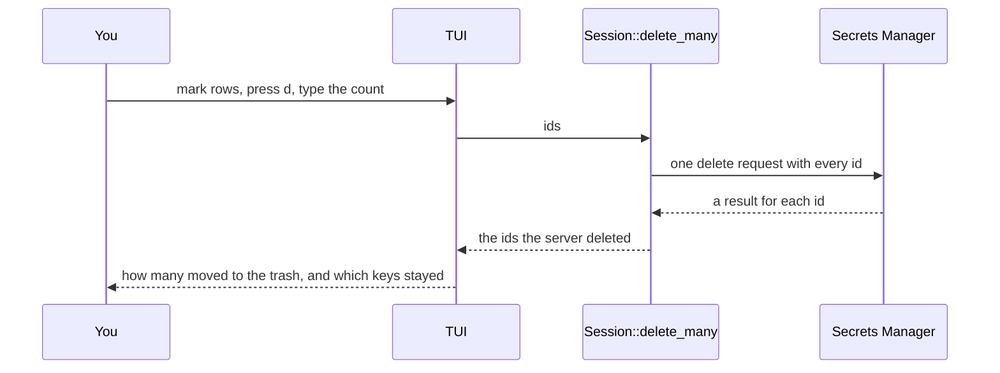
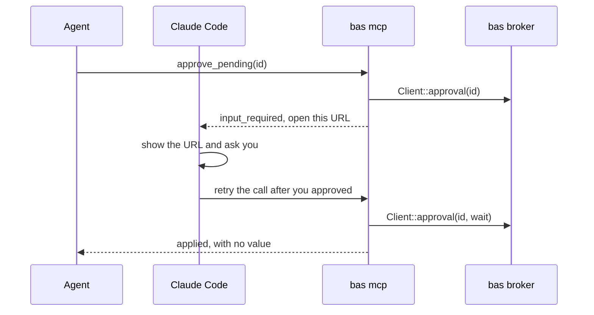

# bas next steps

The brief covers four topics for later work: the TUI, a GUI with GPUI Kit, simpler approvals, and MCP. It was written on 14 Nov 2026 against bas 0.8.7, updated on 15 Nov 2026 after steps 1 and 2 were built, and deepened on 16 Nov 2026 with approval evidence and acceptance criteria.

## Where the work stands

Steps 1 and 2 are on `main`, so don't build them again. The next step to start is step 3.


| Order | Step | Status | Commit |
|---|---|---|---|
| 1 | Sign the macOS release | Done on 15 Nov 2026 | `ef8c596`, `3ec9248` |
| 2 | Marks and bulk delete in the TUI | Done on 15 Nov 2026 | `8bd27ee` |
| 3 | `bas approve ID` signed by a YubiKey | Investigated; implementation awaits trust decisions | |
| 4 | Read-only `bas mcp` | Not started | |
| 5 | GPUI broker viewer | Not started | |

```text
left over from steps 1 and 2
├── release       no release is signed yet, because 0.8.7 was built before step 1
├── measure       keychain prompts across two upgrades, after two signed releases exist
├── TUI           the "bas: plain" note marker, see the TUI section
└── TUI           the case where the server deletes only some marked secrets was never run
```

## Keychain pop-ups

Status: done. The macOS job in `.github/workflows/ci.yml` signs `bas` with one self-signed certificate, so every release has the same signing identity.

The pop-ups came from how the release was signed. An ad hoc signature names a program by the hash of its code, and the hash changes with every release.

```diff
 codesign -d -r- bas
-  designated => cdhash H"cfab20a6..."
+  designated => identifier "dev.bas" and certificate leaf = H"b462b050..."
```

The first plan was a Developer ID, which needs a paid Apple Developer account. A test on the mini (macOS 27.2.1) showed that a self-signed certificate is enough, so no account was bought.

```text
test on the mini, in a throwaway keychain
  build 1 writes an item, build 2 reads it
  both ad hoc                        refused, status -25293
  both signed with one certificate   allowed, status 0
```

```text
Sign the macOS executable  (ci.yml, macOS only)
  write the secret MACOS_SIGNING_IDENTITY to a file
  create a keychain and import the key and certificate
  put the keychain on the search list
  codesign --sign <certificate hash> --identifier dev.bas target/release/bas
  delete the keychain
  fail unless the signature names dev.bas and the certificate
```

| Fact | Effect |
|---|---|
| The key and certificate exist only in the GitHub secret `MACOS_SIGNING_IDENTITY` | A lost secret needs a new certificate, and each Mac asks one more time |
| `gh` on homelab and the mini can't write repository secrets (HTTP 403) | The secret is set on the GitHub web page |
| On the GitHub runner, `codesign` finds an identity only in a keychain on the search list | Keep the `security list-keychains` line |
| `release.yml` passes the secret to `ci.yml` | A new workflow that calls `ci.yml` must pass it too |

| Check | Target | Result |
|---|---|---|
| The macOS job signs with `dev.bas` | Yes | Yes, CI run 43727273327 |
| Keychain prompts across two `mise upgrade` runs | 0 | Not measured, it needs two signed releases |

## Approvals

### Decision and scope, investigated on 16 Nov 2026

`bas approve ID` can bind a signature to a broker request. It cannot, by itself,
prove that the person saw that request's diff. A root-owned executable protects
the executable from replacement, but it does not authenticate its terminal,
parent process, output, or signing prompt. A short code shown in that same
terminal does not provide a second source of trust.

The decision remains yours. Accept a terminal that the agent cannot control as
a prerequisite, or keep the browser approval boundary. Do not describe the
terminal option as equivalent to the browser when the agent controls its
launch environment or terminal. The browser also needs a trusted device and
browser session. HTTPS and WebAuthn do not protect a compromised display.

The task stays limited to approving a pending policy replacement with an
enrolled `ed25519-sk` key. Secret creation and rotation still need the existing
browser input. Passkey management stays on the existing browser flow. Do not
add a GUI, MCP, another approval service, or a new trusted display to make this
task pass. If the trust requirement cannot be met, keep terminal approval
unimplemented and state the reason.

### What the broker already does

The observations below come from source at `8bd27ee`, not a live approval run.

| Source | Existing behavior | Consequence for this task |
|---|---|---|
| `crates/bas-broker/src/server.rs`, `propose_policy` | Stores proposed TOML, the active policy's full SHA-256, and a unified diff | Sign the broker's stored request, never a client-supplied replacement |
| `crates/bas-broker/src/approvals.rs`, `lock` | Expires pending requests after 15 minutes; applying requests no longer expire | Define acceptance at the atomic transition to applying; time spent applying does not renew authorization |
| `approvals.rs`, `start_applying` | Under one map lock, checks pending state, sets applying, and clears challenges | Reuse the single-use transition across browser and terminal submissions |
| `crates/bas-broker/src/state.rs`, `apply`, `replace_policy` | Holds the application mutex across the base hash comparison and policy installation | Preserve the final stale-policy check even after a check before touch |
| `crates/bas-broker/src/pages.rs`, `finish` | Verifies a request's WebAuthn challenge, then starts application in a spawned task | A client disconnect does not cancel an accepted application |
| `crates/bas-broker/src/passkeys.rs`, `finish_assertion` | Requires user verification and an enrolled passkey | SSH enrollment must provide a separate, equally explicit trust decision |
| `crates/bas-broker/src/client.rs`, `socket_path` | Accepts `BAS_BROKER_SOCKET` | The approval client must authenticate its broker instead of trusting this override |
| `crates/bas-broker/src/protocol.rs`, `ApprovalState` | Returns state, result, and error, not the proposal or a nonce | The proposed fetch-and-sign exchange needs additional protocol data |

The broker currently allows several pending requests. The proposed single
pending request restriction is new work. A count checked before touch is not
enough, because another request can arrive before the signature is submitted.
Pending requests live in memory and disappear on broker restart.

### Signature evidence

On homelab, `/usr/bin/ssh-keygen` from OpenSSH 10.2p1 signed a harmless file
with a newly generated software Ed25519 key. `-Y verify` accepted it in the
`bas-approval` namespace. Scratch keys and files were removed after the run.
The absolute executable path avoided the machine's `ssh-keygen` shim, which
routes signing through the broker's SSH agent.

```text
ssh-keygen -Y sign -f <scratch>/key -n bas-approval <scratch>/message
Signing file /tmp/bas-openssh-sign-FIXB4c/message
Write signature to /tmp/bas-openssh-sign-FIXB4c/message.sig
exit=0
Good "bas-approval" signature for probe with ED25519 key
exit=0
```

A second command used Node's built-in Ed25519 signer to produce actual
cryptographic signatures in the OpenSSH security-key wire format. These were
software-generated specimens, not YubiKey signatures or simulated broker
responses. OpenSSH verified the resulting bytes directly.

| Bytes or invocation changed | `/usr/bin/ssh-keygen -Y verify` result |
|---|---|
| Signed flags `0x00`, no presence or verification | Exit 0, good signature |
| Signed flags `0x01`, presence only | Exit 0, good signature |
| Signed flags `0x05`, presence and verification | Exit 0, good signature |
| Same signature verified again | Exit 0 for all three specimens |
| Message changed from `policy=deny` to `policy=allow` | Exit 255, incorrect signature |
| Namespace changed from `bas-approval` to `git` | Exit 255, namespace does not match |
| Requested principal changed from `probe` to `other` | Exit 255, could not verify |

Here is the captured 237-byte SSHSIG specimen with flags `0x00` and counter 1.
Its embedded public key is disposable and holds no account access. The message
is exactly the following UTF-8 text, including its final newline. The request
name and policy text are made-up experiment values.

```text
bas approval experiment
request=example-only
policy=deny
```

```text
-----BEGIN SSH SIGNATURE-----
U1NIU0lHAAAAAQAAAFYAAAAac2stc3NoLWVkMjU1MTlAb3BlbnNzaC5jb20AAAAgL9MZjnlAJEBNIplcQPi9tCQN0gDaQvvROIYxe2bEYbkAAAAQc3NoOmJhcy1hcHByb3ZhbAAAAAxiYXMtYXBwcm92YWwAAAAAAAAABnNoYTUxMgAAAGcAAAAac2stc3NoLWVkMjU1MTlAb3BlbnNzaC5jb20AAABAkYIwUYrbOPLMYMEoKC/ByvKOI61UHr+6+nTfG/3bZwYSdIaTDKf/ipy/hbyoyKba0IzXYE7vkiOMQy5K8GOeDQAAAAAB
-----END SSH SIGNATURE-----
```

To reproduce verification, save the specimen as `approval.sig` and the message
as `message.txt`. Put the following line in `allowed_signers`, then run the
command. All three files contain public experiment data.

```text
probe sk-ssh-ed25519@openssh.com AAAAGnNrLXNzaC1lZDI1NTE5QG9wZW5zc2guY29tAAAAIC/TGY55QCRATSKZXED4vbQkDdIA2kL70TiGMXtmxGG5AAAAEHNzaDpiYXMtYXBwcm92YWw=
```

```sh
/usr/bin/ssh-keygen -Y verify -f allowed_signers -I probe -n bas-approval -s approval.sig < message.txt
```

The experiment establishes that a successful generic SSHSIG verification does
not enforce presence, verification, freshness, or hardware provenance. A
software signer can claim either flag. Enrollment must establish which public
key belongs to the intended physical key; accepting an agent-supplied key just
because its type ends in `-sk` is insufficient.

The [OpenSSH SSHSIG specification](https://github.com/openssh/openssh-portable/blob/V_10_2_P1/PROTOCOL.sshsig)
defines the namespace and message binding. The
[security-key wire specification](https://github.com/openssh/openssh-portable/blob/V_10_2_P1/PROTOCOL.u2f)
defines signed flags and the counter. The
[ssh-keygen manual](https://man.openbsd.org/ssh-keygen.1#FIDO_AUTHENTICATOR)
describes `verify-required` and optional enrollment attestation. The signed
verification flag reports authenticator user verification, not proof that a
fresh PIN was typed for this request or that a person understood its contents.

No YubiKey HID device was exposed on homelab during this investigation. Physical
touch, PIN behavior, and hardware enrollment remain unverified.

### Boundary checks and the physical trace blocker, 16 Nov 2026

The full physical trace has not run. The installed `bas` rejects `approve`,
and the running broker has no SSH-signature submission route. Adding that
route would implement a feature, which this investigation does not authorize.
An existing pending request belonged to other work and was left untouched.

```text
bas approve --help
exit=2
bas: invalid arguments; rejected values are not repeated because they may be secrets. Run `bas --help` or `bas <command> --help`

GET /v1/approvals/00000000-0000-0000-0000-000000000000
HTTP 404, {"error":"no such approval"}

POST /v1/approvals/00000000-0000-0000-0000-000000000000/signature
HTTP 404
```

The route table in `server.rs` confirms the missing endpoint. A 404 for an
unknown ID alone would not prove that a route is absent. The broker's version
was 0.8.7. Homelab exposed an ASUS sound card and an NZXT device through HID,
but no YubiKey. The reachable mini's IOUSB registry had no match for `Yubi`,
`FIDO`, or `Security Key`; its SSH agent listed one ordinary Ed25519 key.
Those observations do not establish where an unplugged key is stored.

For a non-mutating experiment, the running broker supplied its exact active
policy bytes. A local candidate appended only the comment shown below. It
was never proposed to the broker. Two disposable software Ed25519 keys signed
a length-prefixed message using `/usr/bin/ssh-keygen -Y sign`. They were not
enrolled in the broker and did not represent physical YubiKeys.

```diff
--- active
+++ local candidate
+
+# bas consent boundary experiment 2026-11-16
```

```text
active policy SHA256
116e799e72b49f2306b1b0452b316953074075055353f1faf711c752cebd9995
local candidate SHA256
2c20f79a2628af60b014267bd62ba98e4c2e89c8b0e5345c868d883871cf1f31
```

The message used these fields in order. Each field was UTF-8 preceded by its
byte length as a four-byte unsigned big-endian integer. This is an experiment
encoding, not an existing broker protocol. The ID and nonce below are made-up
values, and the expiry was deliberately in the past.

```text
version       1
broker        https://bas.taildfc6b2.ts.net
request ID    11111111-1111-4111-8111-111111111111
kind          policy
base hash     116e799e72b49f2306b1b0452b316953074075055353f1faf711c752cebd9995
proposed hash 2c20f79a2628af60b014267bd62ba98e4c2e89c8b0e5345c868d883871cf1f31
nonce         2222222222222222222222222222222222222222222222222222222222222222
expiry        2026-11-16T20:00:00Z
```

| Attempt | Actual command result | What the result establishes |
|---|---|---|
| Append `x` to each signed field separately | All eight verifications exited 255 | The signature binds the encoded fields, including the two policy hashes |
| Verify the original message with its past expiry | Exit 0 | OpenSSH does not interpret an application expiry field |
| Verify the same message and signature again | Exit 0 | Signature validity is independent of request consumption |
| Parent process replaces the diff line with `+# no policy change to review` | Verification still exited 0 | The signature does not authenticate what a parent process displays; this was a local output-substitution experiment, not an attack on an implemented approval CLI |
| Change the verifier's enrolled public key from A to B, keeping signature A | Exit 255 | A fixed trusted key prevents signer substitution |
| Replace both the trusted public key and signer with B | Exit 0 | Signature verification cannot establish how a key became trusted |
| Fetch the active policy again and run `cmp` against the first fetch | Exit 0 | The broker policy was unchanged during the experiment |
| Submit through the planned signature endpoint | No route exists | Physical signing, broker rejection rules, and application cannot be validated through this path yet |

The following command repeats the field-binding, expiry, replay, and key
substitution checks using the recorded public message fields. It generates
fresh disposable software keys, so fingerprints differ between runs. It
does not contact a broker, use an SSH agent key, or change account access.
All scratch files are removed when the command exits.

```sh
node <<'JS'
const fs = require('node:fs'), os = require('node:os');
const { join } = require('node:path'), { spawnSync } = require('node:child_process');
const dir = fs.mkdtempSync(join(os.tmpdir(), 'bas-consent-evidence-'));
const fields = ['1', 'https://bas.taildfc6b2.ts.net',
  '11111111-1111-4111-8111-111111111111', 'policy',
  '116e799e72b49f2306b1b0452b316953074075055353f1faf711c752cebd9995',
  '2c20f79a2628af60b014267bd62ba98e4c2e89c8b0e5345c868d883871cf1f31',
  '2222222222222222222222222222222222222222222222222222222222222222',
  '2026-11-16T20:00:00Z'];
const encode = values => Buffer.concat(values.map(value => {
  const bytes = Buffer.from(value), length = Buffer.alloc(4);
  length.writeUInt32BE(bytes.length);
  return Buffer.concat([length, bytes]);
}));
const message = encode(fields), file = join(dir, 'message');
const allowed = join(dir, 'allowed_signers');
const run = (args, input) => spawnSync('/usr/bin/ssh-keygen', args, { input, encoding: 'utf8' });
const mustRun = args => { const r = run(args); if (r.status !== 0) throw Error(r.stderr); };
const verify = bytes => run(['-Y', 'verify', '-f', allowed, '-I', 'operator',
  '-n', 'bas-approval', '-s', file + '.sig'], bytes).status;
try {
  for (const name of ['A', 'B']) mustRun(['-q', '-t', 'ed25519', '-N', '', '-f', join(dir, name)]);
  fs.writeFileSync(file, message);
  const enroll = name => fs.writeFileSync(allowed, 'operator ' + fs.readFileSync(join(dir, name + '.pub'), 'utf8'));
  const sign = name => mustRun(['-Y', 'sign', '-f', join(dir, name), '-n', 'bas-approval', file]);
  enroll('A'); sign('A');
  console.log('past expiry', verify(message), 'replay', verify(message));
  fields.forEach((value, index) => {
    const changed = [...fields]; changed[index] = value + 'x';
    console.log('changed field', index, verify(encode(changed)));
  });
  enroll('B');
  console.log('key B with signature A', verify(message));
  fs.rmSync(file + '.sig'); sign('B');
  console.log('key B with signature B', verify(message));
} finally { fs.rmSync(dir, { recursive: true, force: true }); }
JS
```

The next physical run must keep three forms of evidence separate. A recorded
display establishes what a trusted display showed. Signature verification
establishes the signed message and authenticated flags. Broker audit records
and a before-and-after policy diff establish what was applied. No one of
those artifacts proves the other two, and none proves human comprehension.

Until an approval path exists, the acceptance table below is a specification,
not a passed validation. A real YubiKey signature is required to validate
hardware behavior; the software signatures above cannot substitute for it.

### Smallest implementation justified by the evidence

Proceed only after the terminal trust prerequisite and enrollment trust method
are settled. Reuse the current policy request, application mutex, and audit
path. The broker needs an enrolled approval public key, a per-request challenge,
and verification before the existing transition to applying. The CLI needs to
fetch the stored proposal, display it, and sign the broker's exact message.

| Boundary | Required behavior |
|---|---|
| Enrollment | Authorize the exact public key and application through the existing authenticated browser flow, with proof of possession. Establish its physical origin through a trusted enrollment procedure or verified attestation. Proof of possession alone does not prove hardware. Keep the approval key out of the broker's general signing keys. |
| Display | Authenticate the broker socket and its owner. Use the installed system signer with an explicit key handle and controlled environment. Render the full diff without terminal control sequences or invisible text concealing a change. Do not invoke an agent-selected pager, editor, signer, provider, or askpass helper. These measures still require a trusted terminal. |
| Signed message | Use one versioned encoding with fixed field order and length-prefixed fields. Include broker identity, request ID, kind `policy`, full base and proposed policy hashes, a fresh broker nonce, and expiry. The broker constructs and reconstructs these bytes from stored state. A short display code may identify the nonce but cannot replace it. |
| Signature | Require the exact enrolled `sk-ssh-ed25519@openssh.com` key and application, namespace `bas-approval`, valid signature, and authenticated presence and verification bits. Reject ordinary keys and unsupported formats. Do not use `ssh-keygen -Y verify` success as the whole authorization decision. |
| Expiry and replay | Before accepting, expire pending requests and check the stored nonce and request state under the same lock used to consume the authorization. Concurrent duplicate submissions permit at most one application. A restart invalidates old challenges. Never use the hardware counter as the replay defense. |
| Concurrent requests | Enforce the proposed one-pending-request rule atomically at acceptance, across browser and terminal submissions. Treat another applying request as conflicting. If another request appears during review, invalidate the review challenge even if that request later disappears; require a fresh display and touch. Preserve the final base hash check under the application mutex. |
| Completion | Report applied, stale, expired, or rejected separately. A dropped connection must not reapply an accepted request. On restart after a lost reply, inspect current policy and audit state instead of claiming exactly-once completion across crashes. |

The workspace already includes `ssh-key` 0.6.7 through
`ssh_agent_lib::ssh_key`. Its `PublicKey::verify` checks the expected public key
and namespace. Its security-key verifier authenticates the flags but does not
require their values. Inspect `SshSig::signature().as_bytes()` for the verified
security-key trailer and enforce the bits explicitly. Reuse that parser and
cryptography instead of adding a package or writing another SSHSIG parser.
Confirm enabled features with a compile before implementation is considered
ready. No dependency change is justified by this investigation.

### Observable acceptance criteria

Run these cases against an isolated real broker with disposable policy data.
Capture command exit status, returned state, audit events, and `diff` of policy
before and after. The cases below are requirements, not completed tests. No
new automated tests were written in this investigation.

| Case | Required observable result |
|---|---|
| Enrolled physical key, trusted terminal, current policy | The displayed full diff matches the applied policy; one accepted approval and one policy installation appear in the audit. |
| Wrong key, software Ed25519 key, wrong application or namespace, altered signed field, or missing presence or verification | Rejected with no policy mutation and no successful approval event. Software security-key specimens must not become trusted through unattended enrollment. |
| Expired request, canceled request, or old signature after restart | Rejected with no policy mutation; state distinguishes expired, denied, and unknown where retained state permits it. |
| Repeat the signature, including simultaneous submissions and browser versus terminal submissions | At most one application; later submissions cannot reactivate the request. |
| Policy changes after display and before application | The stale request fails; the current policy remains in place. The error names the stale request ID and requires a fresh review. |
| A second request arrives during review, including one then canceled | The old challenge cannot apply; another display and touch are required after the conflict is resolved. |
| Redirected socket, substituted signer environment, terminal escape sequences, or hidden diff text | The client rejects an unauthenticated broker or unsafe input. A hostile terminal remains a failed trust prerequisite, not a claim fixed by root ownership. |
| Disconnect after acceptance | The request completes once; reconnecting reads status without resubmitting an application. |
| Physical enrollment and signing | Capture a real YubiKey signature with both required bits, verify it independently, and record actual touch and PIN prompts. Keep PINs and private handles out of evidence. |

Security acceptance precedes timing. Once it passes, compare the terminal and
browser flows using the same policy change and record elapsed time and human
actions. Do not trade a failed consent guarantee for fewer seconds.

### Choices that remain yours

| Choice | Consequence |
|---|---|
| Trust a terminal outside the agent's control | Allows a conditional terminal approval design; requires a concrete way for you to identify and use that terminal. |
| Require protection when the agent controls the terminal | The proposed terminal flow cannot meet the requirement; retain the browser boundary. |
| Trust a physical enrollment procedure or require hardware attestation | The former trusts the enrollment device and ceremony; the latter needs a verified attestation chain and its privacy and compatibility tradeoffs assessed before implementation. |

### Earlier observations retained as inputs

The following observations were recorded on 15 Nov 2026 and were not rerun
during this investigation.

| Fact seen on 15 Nov 2026 | Effect on step 3 |
|---|---|
| The broker refuses an approved request when the active policy changed after the request was made | Two agents that propose at the same time block each other, so `bas approve ID` should say which request is out of date |
| A proposal is the whole policy file, and a leftover line from another agent's request goes along with the next request | Show the full diff before the YubiKey touch, as the approval page does today |
| On the Macs, `bas` is a mise shim that sets `VISUAL` to `code-insiders --wait` and replaces the caller's value | A scripted edit on a Mac must call `$(mise which bas)` with its own `VISUAL` |
| VS Code Insiders on the mini saves a sorted copy over an open `policy.toml` | A proposal file can differ from the active policy without anyone editing it |
| homelab and the mini each have their own policy, and both had hash `116e799e` on 15 Nov 2026 | A change must be proposed and approved on each machine |

## TUI

Status: marks and bulk delete are done. The `bas: plain` note marker and bulk edit aren't built, and neither is in the order above.

```diff
 App.screens  (crates/bas-tui/src/app.rs)
 ├── Projects     Enter open, n new, e rename, d delete
+│                g top, G bottom
 ├── Secrets      / filter on keys only, Enter view, e edit, n new, d delete
+│                Space mark, Esc clear marks, g top, G bottom
+│                d with marks deletes them after you type the count
 ├── Secret       r reveal, c copy, e edit, d delete
 ├── Form         edit key, value, note
 └── WebVault
```

```diff
 struct SecretsScreen {
     items: Vec<Identifier>,
     filter: String,
     selected: usize,
+    marked: BTreeSet<Uuid>,
 }
```



```text
run on homelab against Secrets Manager, 15 Nov 2026
  4 dummy secrets, 3 marked
  d, type 2, Enter    nothing happens
  d, type 3, Enter    "Moved 3 secrets to trash", 1 secret left
  Space, d, 1, Enter  "Moved 1 secret to trash", list empty
```

| Fact | Effect on the design |
|---|---|
| `bitwarden-sm` 3.0.0 deletes a list of IDs in one call | Bulk delete needed no SDK change |
| Deleted secrets go to the trash, and only an admin restores them | The TUI can't undo, so it confirms with the count |
| A mark stays while the filter hides its row | The dialog names the keys before you confirm |
| There's no bulk update | Bulk edit is one update per secret, and some may fail |
| A secret has only key, value, note, and project | A value that isn't secret needs a marker in the note |

| Fact for whoever tests the TUI | Effect |
|---|---|
| The secrets screen needs a machine token, and homelab stores none | Ask for the token with a secret prompt and pass it as `BWS_ACCESS_TOKEN` |
| The machine token can't create a project (HTTP 400) | A new secret lands in an existing project, so name test secrets `PROBE_` and filter on it |
| The mini's token is in the login keychain, which ssh can't open | Run the mini's secrets screen at the mini itself |

Not built: the note marker for a value that isn't secret.

```text
on(open a secret)
  if the note has a line "bas: plain"
    show the value without hiding it
  else
    hide the value until you press r
```

## GUI with GPUI Kit

The library is `longbridge/gpui-kit`, version 0.9.1, built on Zed's GPUI. It runs on macOS, Windows, and Linux.

| Gives | Costs |
|---|---|
| Tables, trees, lists, inputs, dialogs, themes | About 1,245 crates in its lock file |
| Mouse use, sorting, a window that stays open | A binary of tens of MB |
| Reuse of the broker client and policy summaries | Linux libraries for X11, Wayland, and Vulkan |
| | A newer Rust than the workspace's 1.89 |
| | No tray icon, OS notifications, or Touch ID |

```text
crates/bas-gui  (outside the default build)
└── BasWindow
    ├── Sidebar         Policy, Requests
    ├── PolicyView      ActivePolicy::entries, grouped by EntryKind
    └── RequestsView    PendingRequest list, button opens the approval page
```

| Keep it if | Target |
|---|---|
| Clean build time | Under 10 minutes |
| Release binary | Under 40 MB |
| Runs on the mini | Yes |
| A request from `bas add` shows | Within 2 seconds |

## MCP

MCP can show an approval link inside the agent's client, so the agent doesn't sit in `bas policy edit`. The current spec says a server must use a URL, and never a form, for anything sensitive.



```text
bas mcp  (stdio, runs as the agent's user)
├── policy_entries     read only    Client::policy
├── broker_status      read only    Client::status
├── approve_pending    shows the link of a request bas policy edit started
└── never              bas get, values, forms
```

| Risk | Handling |
|---|---|
| Claude Code may not support URL links yet (user reports, unconfirmed) | Return the link as text |
| The server runs as the agent's user | It gets no more power than the CLI |
| Audit entries hold request paths | Mark them as untrusted text |

| Measure | How |
|---|---|
| Your turns and minutes to approval | Three changes through the skill, three through MCP |
| No value reached the model | Search `~/.claude/projects` for a test value |

## A thorough bas doctor

Status: implemented as `bas doctor --broker` and verified on homelab on 16 Nov 2026.
The results are under "Verification results" below. Keep this increment to Git signing, client and broker compatibility,
and policy references. Physical YubiKey verification is postponed until the operator
is present, as the final manual step. It is not evidence required for the broker's
software signing key.

### Evidence from the current installation

The investigation used the installed commands, effective Git configuration, socket
responses, and source code. The earlier incident descriptions are leads, not retained
failure transcripts. The compatibility fix in commit `a31f6d2` records that a 0.8.5
client rejected a policy field from a 0.8.6 broker.

| Actual probe | Observed result | What it establishes |
|---|---|---|
| `bas doctor` | Build 0.8.7, one profile, machine token not configured, exit 0 | Only the existing offline checks passed. Homelab normally has no client machine token. |
| `BAS_BROKER_SOCKET=/dev/null bas policy show` | Connection refused, exit 1 | This invocation could not reach its selected broker. |
| `BAS_BROKER_SOCKET=/dev/null bas doctor` | Same offline rows, exit 0 | Today's doctor does not inspect the broker. |
| `GET /v1/status` through `/run/bas/broker.sock` | HTTP 200, version 0.8.7 | The running broker answered this request. |
| `GET /v1/policy` and `bas policy show` | HTTP 200, 11 readable entries with 13 distinct references | The current client can display the active policy. Secret existence remains unchecked. |
| Fresh `git commit-tree -S` with isolated object storage, then `git verify-commit` | Good Git signature, both commands exited 0 | Effective signing and local trust verification worked in this repository. No branch was updated. |
| Verify that commit with `-c gpg.ssh.allowedSignersFile=/dev/null` | No principal matched, exit 1 | A valid signature alone does not establish local trust. |
| Sign with `-c user.signingkey=bas:git_signing` | Could not load public key, nonzero exit | The agent comment is not a signing key path. The old proposed fix was invalid. |
| Verify a detached signature against changed message bytes | Incorrect signature, exit 255 | Independent OpenSSH verification rejects altered content. |
| `GET /v1/doctor/references` | HTTP 404 | The proposed metadata check is unavailable on this broker. It says nothing about missing secrets. |

Effective settings came from `/etc/gitconfig` and `~/.gitconfig` in the repository's
working directory. `gpg.format` is `ssh`, `user.signingkey` is
`~/.ssh/git_signing.pub`, and `gpg.ssh.allowedSignersFile` is
`~/.config/git/allowed_signers`. The signing program is
`/usr/local/lib/bas/shims/ssh-keygen`. Its installed contents select
`/run/bas/ssh-agent.sock` before executing `/usr/bin/ssh-keygen`.
The public key fingerprint observed in verification was
`SHA256:3+bvJJP58M7vROs+IrPMI8vhDlypInjhTMJCYkeUn2k`.

### What each result means

Each result needs a stable check name, status, evidence, and a conditional fix.
Use `warning` with an explicit reason when evidence is unavailable. Do not convert
a timeout, unsupported configuration, or refused request into either success or a
claim that a secret was deleted. Exit 1 if any check fails, otherwise 2 if any check
warns, otherwise 0. Keep `not configured` for optional setup that was not requested.

| Check | Ready | Failed | Warning or unavailable evidence |
|---|---|---|---|
| Git signing | A fresh disposable commit is signed through effective Git settings and accepted by `git verify-commit`. | A supported signing configuration produces an explicit signing failure or fails trust verification. Report the stage that failed. | No repository, unsupported signing format or key selection, uninspected signing wrapper, hardware interaction, or timeout prevents the probe. |
| Client and broker compatibility | The current client decodes status and displays the active policy through `ActivePolicy::entries()`. Name the operations actually checked. | A returned required reply or policy cannot be decoded, or access is explicitly refused. Report decoding and authorization separately. | The socket is unreachable, a request times out, or a required diagnostic endpoint is unsupported. Different version strings are a warning about drift, not proof of incompatibility. |
| Policy references | A complete successful identifier listing contains every distinct reference in the policy snapshot. | A completed, nonempty listing omits a reference. Say "not visible to the broker's machine account", not "deleted". | Listing fails, times out, is empty despite a nonempty policy, cannot establish completeness, or the policy changes before results can be associated with the current snapshot. |

Signing readiness applies to the current repository and effective configuration.
It does not prove another repository, another identity, remote GitHub trust, or the
future availability of a key. The shell's `SSH_AUTH_SOCK` and `ssh-add -L` are not
authoritative when the signing program selects a different agent. Even a key listed
by the correct agent can refuse signing because its policy allows only `auth`.

Compatibility readiness covers status and policy display, not every API operation.
Equal version strings cannot prove compatibility. Different versions are allowed
by the [socket reply contract](../docs/src/reference/socket-api.md).
`ActivePolicy::entries()` uses broker summaries when present and parses policy text
only when summaries are absent. Preserve that behavior instead of adding a second
policy parser or rejecting every unequal version.

Reference readiness establishes identifier visibility at the time of the request.
It does not establish that a value decrypts, has the right format, still works with
its upstream service, or remains visible after the check. A deleted secret and a
secret hidden by permissions are indistinguishable from an absent identifier.

### Smallest implementation

Add `bas doctor --broker` to run these three checks explicitly. Preserve the current
offline default and the existing `--profile` behavior. Add `--json` for the same
results as the text output, with no second diagnostic path. Do not add a daemon,
new dependency, general plugin system, or automatic repair.
Resolve the socket through `client::socket_path()` so `BAS_BROKER_SOCKET` has the
same meaning as it does for `bas policy show`.

| Existing owner | Small change |
|---|---|
| `crates/bas/src/cli.rs`, `doctor.rs`, `main.rs`, and `output.rs` | Add the opt-in checks, warning status, structured evidence and fix fields, JSON output, and exit aggregation. Existing offline checks remain usable. |
| Git subprocesses inside the doctor | Read only the signing configuration keys with origin and scope. Let Git select the key and verify trust. Use a disposable object directory without changing refs, the index, hooks, or config. |
| `crates/bas-broker/src/client.rs`, `error.rs`, and `protocol.rs` | Reuse status and policy requests. Add the typed reference diagnostic request and reply. Preserve the HTTP status in client errors so endpoint 404 and authorization 403 remain distinguishable without parsing message text. Preserve additive reply compatibility. |
| `crates/bas-broker/src/server.rs` and `policy.rs` | Add authenticated `GET /v1/doctor/references`, using the existing peer UID check. Enumerate references from typed policy entries and retain each owner and field. |
| `crates/bas-core/src/secrets.rs` | Reuse `Session::list_identifiers(None)`, which uses metadata endpoints without secret values. No new credential path is needed. |

First support the inspected shipped signing shim with an explicit public key path
or Git's `key::` public key form. Other wrappers, `gpg.ssh.defaultKeyCommand`, private
key files, and hardware keys must report that the noninteractive probe is unsupported
until their no-prompt behavior is established. Do not execute arbitrary key discovery
commands during the default diagnosis. Run subprocesses without terminal input and
terminate the whole probe on a deadline. A timeout alone does not prevent a hardware
prompt, so hardware exclusion must happen before invocation.

Use a ten second deadline for each signing or socket probe. Apply a ten second
deadline to the broker's metadata request too, so cancellation cannot leave an
unbounded upstream operation. An empty policy needs no upstream request and reports
zero checked references. Return fixed diagnostic messages, never raw upstream bodies,
private key contents, tokens, secret values, or complete environment output.

For references, capture one policy snapshot and enumerate `secret.ref`, `helper.ref`,
`ssh.ref`, `github.private_key`, optional `github.user_token`, `tailscale.client_id`,
and `tailscale.client_secret`. Deduplicate requests by identifier but retain every
policy location in the result. Use the organization listing, not the broker's project
filter, because valid references may point outside the default creation project.
The parser already requires every reference to use the broker's profile.

Return the snapshot's existing policy identity, checked count, and per-reference
visibility. Compare against the current policy identity before reporting readiness.
If it changed, report a warning and ask for a rerun. Never return an empty missing
list as success when the upstream request failed. Neither `Session::get` nor
`bas get` belongs in this diagnostic.

The locked `bitwarden-sm` 3.0.0 implementation calls the organization identifier
endpoint once. Its `secrets/list.rs` converts `response.secrets` with
`unwrap_or_default()`, so a missing or null field becomes an empty successful list.
The generated `SecretWithProjectsListResponseModel` has no continuation token, and
the SDK result exposes no completeness marker. An empty result with policy references
must therefore warn that visibility could not be established. Do not claim that all
references are missing. A nonempty result supports comparison under the endpoint's
complete-list contract, but cannot prove the remote server fulfilled that contract.
Keep server behavior validation in the isolated verification work. No new package,
direct credential access, or secret value fetch is needed for this conservative rule.

The client currently keeps HTTP status only in some rendered refusal messages and
classifies all such responses as `ErrorKind::Refused`. Retain the status as data at
the response boundary before adding the diagnostic. An optional HTTP status field
on `Error`, set by `refused()`, is sufficient. A 403 is an access failure,
whereas a 404 on the new reference endpoint is an unsupported-check warning.

### Fixes must follow the observed failure

| Evidence | Concrete fix to show, without applying it |
|---|---|
| Git selected the wrong signing program | Set `gpg.ssh.program` at the winning configuration scope to the installed `/usr/local/lib/bas/shims/ssh-keygen`. |
| The configured public key is absent or not held by the selected agent | Select the intended broker signing key's public key file, such as the verified `~/.ssh/git_signing.pub`, or its `key::` public key. Never substitute the comment `bas:git_signing`. |
| Signing succeeds but trust verification fails | Correct `gpg.ssh.allowedSignersFile` and its trusted principal, namespace, validity, or revocation rule as the evidence requires. Do not remove revocation or trust checks to make the probe pass. |
| Client cannot decode the broker's policy | Update the client to a release supporting broker entry summaries, then rerun policy display. Inspect the actual reply if an updated client still fails. |
| Installed binary is newer than the broker process | Restart the broker through its configured service manager, then query `/v1/status` again. Updating a binary does not replace a running process. |
| Required diagnostic endpoint returns 404 | Update the broker to a release containing the endpoint and restart it. Keep the reference result unavailable until then. |
| A completed metadata listing omits a policy reference | Check the broker machine account's project access. Restore intended access, or propose the correct reference with `bas policy edit` for approval. Do not delete or rotate a secret automatically. |
| Listing or socket access fails | Restore the reported connection, authentication, or UID access first. Rerun the check before changing a reference. |

### Repeatable verification

These are real command probes, not a request for new unit tests, integration tests,
mocks, or an E2E suite. Record stdout, stderr, and exit status with nonsecret inputs.
Use process-local overrides and disposable files, then remove them. Do not change
live policy, live credentials, Git settings, or running services to manufacture a
failure. The future broken broker cases require an isolated authorized setup and
remain unverified until that setup exists.

The following Git probe was run from this repository in zsh. It keeps Git's effective
configuration and stores the disposable commit outside the repository's object
directory. The trap removes the probe on exit. No branch or index changes.

```sh
set -eu
probe_objects=$(mktemp -d)
trap 'rm -rf "$probe_objects"' EXIT
probe_source_objects=$(git rev-parse --path-format=absolute --git-path objects)
probe_commit=$(GIT_OBJECT_DIRECTORY="$probe_objects" \
  GIT_ALTERNATE_OBJECT_DIRECTORIES="$probe_source_objects" \
  timeout 10 git commit-tree 'HEAD^{tree}' -S -m 'bas doctor signing probe')
GIT_OBJECT_DIRECTORY="$probe_objects" \
  GIT_ALTERNATE_OBJECT_DIRECTORIES="$probe_source_objects" \
  git verify-commit "$probe_commit"
```

Repeat verification before cleanup with
`git -c gpg.ssh.allowedSignersFile=/dev/null verify-commit "$probe_commit"`, keeping
the same object-directory variables. It must fail. Repeat signing with
`git -c user.signingkey=bas:git_signing commit-tree 'HEAD^{tree}' -S -m 'probe'`
and the same variables. It must fail. Handle those expected nonzero statuses instead
of letting `set -e` end a combined probe early. The working run must still pass after
the process-local overrides are removed.

| Case | Independent command or setup | Required result |
|---|---|---|
| Current broker | `curl --max-time 5 --unix-socket /run/bas/broker.sock http://localhost/v1/status`, then `bas policy show` | Report the actual version and readable policy. Once implemented, doctor agrees. |
| Unreachable broker | `BAS_BROKER_SOCKET=/dev/null bas policy show` | Connection failure. Future `bas doctor --broker` must not report compatibility or reference readiness. |
| Unequal versions | Run actual supported client releases against an isolated broker with readable policy | Policy decoding succeeds despite version drift. No invented incompatibility error. |
| Incompatible policy display | Run the historical old client against an isolated newer broker with the field that broke parsing | Capture the actual parsing failure. Updating the client restores display. A recorded incident alone is not a rerun. |
| Visible reference | Compare the isolated broker's diagnostic with its successful identifier listing | Every listed policy reference is ready without fetching values. |
| Absent reference | Put a newly generated, unlisted UUID in the isolated broker's policy | Report not visible, never proven deleted. A valid replacement restores readiness. |
| Metadata request fails | Use the isolated setup's rejected credential or unreachable API | Report unavailable evidence, never all references missing or all references ready. |
| Empty metadata result with policy references | Use an isolated machine account with no visible identifiers | Report unavailable evidence because the SDK cannot distinguish an empty list from a missing response field. Do not claim deletion. |
| Policy changes during lookup | Approve a policy change only in the isolated setup while a lookup runs | Associate results with their snapshot and refuse to report them as current readiness. |
| Prompt exclusion | Inspect unsupported key selection before starting a subprocess | A warning appears without launching hardware interaction. Physical YubiKey checks remain the final manual step. |

### Verification results, 16 Nov 2026

Every row is a real run on homelab. The Git cases used process-local
`GIT_CONFIG_COUNT` overrides in a disposable repository. The broker cases used a second
broker started by hand on its own sockets and ports under `/tmp`, with a one-entry test
policy and a machine token supplied for the run. The live broker, its policy, the Git
settings, and every secret stayed unchanged. No secret value was read. The scratch
files were removed afterwards.

| Case | Independent command | `bas doctor --broker` |
|---|---|---|
| Effective Git settings | `git commit-tree -S` exit 0, `git verify-commit` exit 0 | `git signing` ready |
| `user.signingkey=bas:git_signing` | Signing exit 1, could not load public key | failed at signing, exit 1 |
| `gpg.ssh.allowedSignersFile=/dev/null` | Verify exit 1, no principal matched | failed at trust verification, exit 1 |
| Overrides removed | Sign and verify exit 0 | ready again |
| `gpg.ssh.program=/usr/bin/ssh-keygen` | Not signed, it is not the inspected shim | warning |
| `sk-ssh-ed25519` key | `strace` saw only `git config` and `git rev-parse` start | warning before any signing program |
| Key path or program is a FIFO | Not applicable | warning in under one second |
| Trust file is a FIFO | Git blocks | warning after 10 seconds, no process left |
| Outside a repository | `git rev-parse` fails | warning |
| Live broker 0.8.7 | `curl /v1/status` 200, `bas policy show` 11 entries | compatibility ready, references warn on HTTP 404 |
| `BAS_BROKER_SOCKET=/dev/null` | `bas policy show` connection refused | both broker checks warn, exit 2 |
| Released 0.8.5 client, live 0.8.7 broker | `bas policy show` exit 1, unknown field `user_token` | The historical failure, reproduced |
| Released 0.8.6 client, live 0.8.7 broker | `bas policy show` exit 0, 11 entries | Unequal versions decode |
| This client, isolated released 0.8.6 broker | `curl /v1/status` says 0.8.6, references 404 | compatibility warns about drift, references warn, exit 2 |
| Isolated broker, one real reference | `curl /v1/doctor/references` says `listed`, `visible: true` | all three ready, exit 0 |
| A newly generated UUID added in two policy places | Reply says `visible: false` with both locations | failed, "not visible to the broker's machine account", exit 1 |
| That UUID removed | Reply says `listed`, all visible | ready, exit 0 |
| Empty policy | Reply says `not_needed` | ready, 0 checked |
| Isolated broker with an API address that refuses connections | Reply says `failed` | warning, exit 2 |
| A real policy approval lands while a slowed listing is in flight | Reply says `policy_changed` with the old policy hash | warning, hashes before and after differ, exit 2, and a rerun is ready |
| The listing is slowed past the broker's 10 second deadline | Reply says `timed_out` | warning, exit 2 |
| `gpg.ssh.defaultKeyCommand` set, with a signing key also set | `strace` saw no signing program start | warning, and the command's value is not printed |

The approval in the policy change row was real. A software passkey from Chrome's virtual
authenticator was enrolled in the isolated broker and approved a one-line policy change
on its approval page. A local tunnel proxy delayed the broker's Secrets Manager traffic
so that the listing took about four seconds.

A stand-in socket server sent canned replies for the outcomes no real broker could be
made to produce here. It proves only how the client reads them. `empty`, an unknown
outcome, a policy hash that changes between the two status reads, and a reply slower
than 10 seconds each gave a warning. HTTP 403 on status gave
failed with "authorization". An undecodable policy reply gave failed with "decoding".

When the broker's listing and the client's wait both end at 10 seconds, the client can
give up first. The result is still a warning, with the connection fix instead of the
timeout wording.

On the mini (macOS 27.2.1) the same commit built, and `bas doctor --broker` reported
`git signing` ready and `broker compatibility` ready against its live 0.8.7 broker. With
`user.signingkey` set for one process to the `sk-ssh-ed25519` public key file, it warned
in under a second and asked for no touch.

The physical YubiKey signature did not run. Homebrew's `ssh-keygen -Y sign` from OpenSSH
10.6p2 asked for presence and then answered "device not found" for both hardware keys,
and the mini's IO registry listed no FIDO HID device at that time.

Still unverified: an empty listing from a real machine account with no visible secrets,
a real YubiKey signature, and the Windows build. Signing requests add normal broker
audit entries.

Implementation references are [doctor.rs](../crates/bas/src/doctor.rs),
[protocol.rs](../crates/bas-broker/src/protocol.rs),
[ssh_agent.rs](../crates/bas-broker/src/ssh_agent.rs), and
[Session::list_identifiers](../crates/bas-core/src/secrets.rs).
The [Git configuration manual](https://git-scm.com/docs/git-config) defines effective
signing configuration and local trust. The
[OpenSSH manual](https://man.openbsd.org/ssh-keygen.1) defines detached signature
verification. Neither an agent comment nor a version string substitutes for those
operation results.

The broader wishlist remains deferred. It includes macOS code signing and keychain
prompts, passkey inventory, proxy checks, SSH login configuration, GitHub login, and
Tailscale connectivity. None belongs in this first increment.
